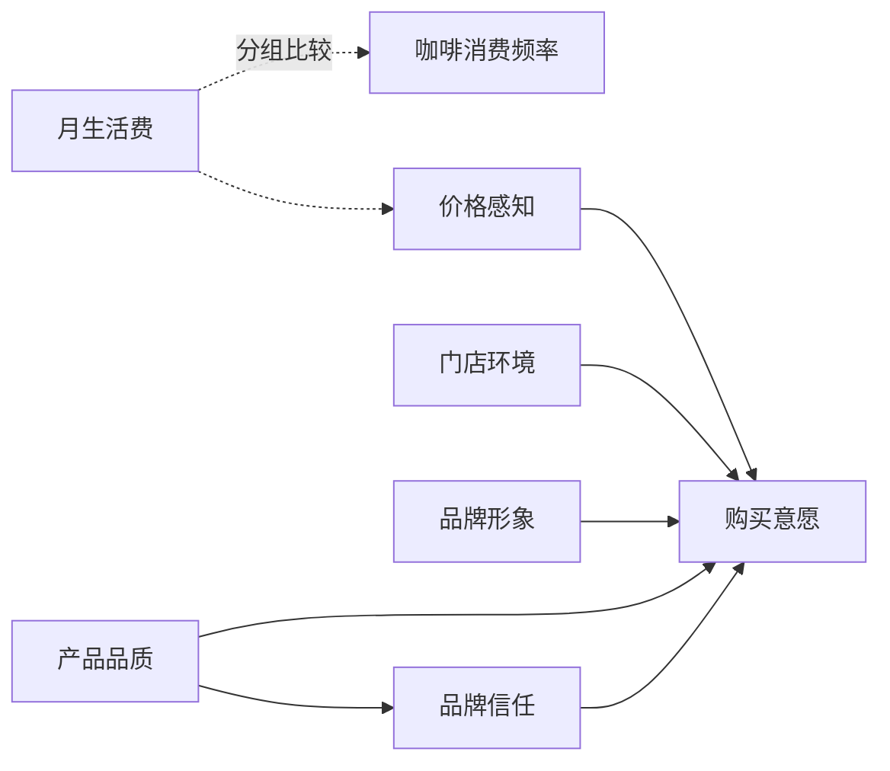

# 《大学生现制咖啡消费行为与品牌选择研究》数据需求文档

> **项目名称**：大学生现制咖啡消费行为与品牌选择研究  
> **竞赛/课程**：正大杯全国大学生市场调查与分析大赛  
> **研究类型**：市场调查  
> **行业/区域**：现制饮品/咖啡｜武汉市  
> **目标总体**：武汉市高校在校大学生  
> **文档版本**：v1.0  
> **生成日期**：2026-10-20  
> **生成方式**：data-requirement skill + 本地规则引擎  
> **文档用途**：作为问卷设计、数据采集、清洗与统计建模的统一依据  

---

## 0. 文档摘要

本文件面向《大学生现制咖啡消费行为与品牌选择研究》的数据分析部分，回答“需要什么数据、如何取得、用什么方法分析”三个问题。文档中的变量、样本参数、模型方法与质控措施相互对应，可直接用于问卷定稿、调研执行和分析分工。

- **研究主题**：大学生现制咖啡消费行为与品牌选择研究
- **核心研究问题**：6 个，见 1.2；其中可转化为统计假设的 4 条
- **变量体系**：17 个变量（含控制与筛选变量），核心构念 8 个
- **样本方案**：目标有效样本 **461** 份，计划发放 **543** 份
- **核心方法**：描述性统计、李克特量表、信度检验：Cronbach's α、词频分析与词云、简单随机抽样与样本量测算、效度检验：KMO 与巴特利特检验、方差分析（ANOVA）、交叉分析（列联表与多重响应）、卡方检验、多元线性回归、TF-IDF、SnowNLP 情感分析、结构方程模型 SEM
- **主要渠道**：高校校园社群 / 班级群、小红书、微信朋友圈 / 微信群、问卷星 / 腾讯问卷
- **质量控制**：覆盖设计、抽样、执行、清洗、分析、交付 6 个阶段，共 39 项控制点
- **数据交付**：原始数据、清洗数据、变量字典、清洗日志、分析脚本

---

## 1. 研究概述

### 1.1 研究背景

近年来，现制咖啡在高校周边快速扩张，瑞幸、库迪、星巴克等品牌通过价格带、门店位置与联名营销争夺大学生客群。大学生咖啡消费具有高频、价格敏感、社交传播强等特点，但现有研究多聚焦白领或城市居民，对大学生在不同品牌间的选择逻辑、品牌信任的形成机制以及价格与品质的权衡关注不足。本项目以武汉市高校为例，识别大学生现制咖啡消费的主要影响因素，为品牌在校园市场的产品、定价与渠道策略提供依据。

### 1.2 研究问题

| 编号 | 研究问题 | 问题类型 | 来源 |
| --- | --- | --- | --- |
| RQ1 | 武汉市大学生的现制咖啡消费频率、客单价与消费场景呈现怎样的特征？ | 现状与结构描述 | input |
| RQ2 | 不同性别、年级、月生活费的大学生在咖啡消费频率上是否存在显著差异？ | 群体差异比较 | input |
| RQ3 | 产品品质、价格感知、门店环境、品牌形象对大学生购买意愿有何影响？ | 影响因素 | input |
| RQ4 | 品牌信任是否在产品品质与购买意愿之间起中介作用？ | 影响因素、中介机制 | input |
| RQ5 | 月生活费是否调节价格感知对购买意愿的影响？ | 影响因素、调节效应 | input |
| RQ6 | 大学生对瑞幸、库迪、星巴克等品牌的提及频率与情感倾向如何？ | 文本与舆情 | input |

### 1.3 研究目标

- 描述武汉市大学生现制咖啡的消费频率、客单价、场景与品牌认知现状。
- 识别影响大学生购买意愿的关键因素，并比较其相对重要性。
- 检验品牌信任的中介机制与月生活费的调节作用。
- 基于公开评论分析主要品牌的口碑差异，提出校园市场策略建议。

### 1.4 研究范围与调查单位

| 项目 | 内容 |
| --- | --- |
| 目标总体 | 武汉市高校在校大学生 |
| 调查单位 | 个人 |
| 研究区域 | 武汉市 |
| 所属行业 | 现制饮品/咖啡 |
| 研究类型 | 市场调查 |
| 数据来源 | 一手问卷、公开文本/评论、二手行业数据 |
| 调查方式 | 线上为主 |
| 约束条件 | 预算约 3000 元，以线上问卷为主，校园社群与线下拦截为辅；调研周期 6 周，团队 5 人，其中 2 人负责数据采集；样本需覆盖不同年级与专业，避免集中在单一学院；公开评论仅使用平台公开数据，不抓取个人身份信息 |

### 1.5 概念框架

下图给出变量之间的核心关系。实线表示影响路径，虚线表示调节或分组比较；中介路径与具体系数将在第 5 章对应模型中检验。



| 构念 | 角色 | 操作化定义 |
| --- | --- | --- |
| 咖啡消费频率 | 因变量 | 过去一个月购买现制咖啡的频次（从不/每月1—2次/每周1—2次/每周3—5次/几乎每天） |
| 购买意愿 | 因变量 | 未来一个月内购买或推荐现制咖啡的可能性 |
| 产品品质 | 自变量 | 对咖啡口感、用料、出品稳定性的评价 |
| 价格感知 | 自变量 | 对价格合理性、性价比与优惠力度的感知 |
| 门店环境 | 自变量 | 对门店位置、座位、氛围与卫生的评价 |
| 品牌形象 | 自变量 | 对品牌知名度、个性与口碑的评价 |
| 品牌信任 | 中介变量 | 对品牌可靠、诚实与善意的信任程度 |
| 月生活费 | 调节变量 | 每月可支配生活费区间 |

### 1.6 数据需求总览

| 数据类型 | 用途 | 采集方式 | 目标规模 | 粒度 | 交付格式 |
| --- | --- | --- | --- | --- | --- |
| 一手问卷数据 | 核心变量测量、假设检验、建模 | 线上/线下问卷 | 计划发放 543 份 | 个体层面 | 问卷星/渠道平台导出 Excel/CSV |
| 公开文本/评论 | 情感、主题、关键词、竞品对比 | 平台公开评论、开放题 | 有效文本≥100 条；LDA 建议≥500 条 | 文本条目 | CSV（文本、时间、来源、评分等字段） |
| 二手行业数据 | 背景论证、市场容量、趋势与区域对比 | 统计年鉴、行业报告、指数平台 | 按研究需要 | 行业/区域/年度 | 来源清单 + 摘录表 |

---

## 2. 研究假设

假设是连接研究问题与统计模型的桥梁。以下假设均给出变量、预期方向与检验方法；正式报告中应同时报告原假设（H0）与备择假设（H1）的检验结果，而不能只挑选显著结果。

### 2.1 假设体系

| 编号 | 假设内容 | 类型 | 对应RQ | 自变量 | 因变量 | 中介/调节 | 预期方向 | 检验方法 |
| --- | --- | --- | --- | --- | --- | --- | --- | --- |
| H1 | 不同性别、年级、月生活费的受访者在咖啡消费频率上存在显著差异。 | 差异 | RQ2 | 性别、年级、月生活费 | 咖啡消费频率 | — | 存在差异 | 方差分析（ANOVA） / 交叉分析（列联表与多重响应） |
| H2 | 产品品质、价格感知、门店环境、品牌形象对购买意愿具有显著影响。 | 影响 | RQ3 | 产品品质、价格感知、门店环境、品牌形象 | 购买意愿 | — | 待逐项检验 | 多元线性回归 / 结构方程模型 SEM |
| H3 | 品牌信任在产品品质与购买意愿之间起中介作用。 | 中介 | RQ4 | 产品品质 | 购买意愿 | 品牌信任 | 存在中介 | 多元线性回归 / 结构方程模型 SEM |
| H4 | 月生活费调节价格感知对购买意愿的影响。 | 调节 | RQ5 | 价格感知 | 购买意愿 | 月生活费 | 存在调节 | 多元线性回归 / 结构方程模型 SEM |

### 2.2 假设说明与检验口径

**H1｜不同性别、年级、月生活费的受访者在咖啡消费频率上存在显著差异。**

- **理论依据**：消费者行为理论（个体差异视角）：人口统计特征通过资源约束、生活方式与社会角色影响消费行为
- **变量关系**：性别、年级、月生活费 → 咖啡消费频率
- **检验方法**：方差分析（ANOVA） / 交叉分析（列联表与多重响应）
- **判定标准**：p<0.05 视为统计显著；同时报告效应量（如 β、OR、η²、R²）与 95% 置信区间；若进行多组比较，需说明多重比较校正方法。
- **结果表述**：显著时说明方向与强度；不显著时表述为“未发现显著证据”，不能直接认定为“没有影响”。

**H2｜产品品质、价格感知、门店环境、品牌形象对购买意愿具有显著影响。**

- **理论依据**：计划行为理论（TPB）/ 技术接受模型（TAM）：态度、主观规范与感知行为控制影响行为意愿
- **变量关系**：产品品质、价格感知、门店环境、品牌形象 → 购买意愿
- **检验方法**：多元线性回归 / 结构方程模型 SEM
- **判定标准**：p<0.05 视为统计显著；同时报告效应量（如 β、OR、η²、R²）与 95% 置信区间；若进行多组比较，需说明多重比较校正方法。
- **结果表述**：显著时说明方向与强度；不显著时表述为“未发现显著证据”，不能直接认定为“没有影响”。

**H3｜品牌信任在产品品质与购买意愿之间起中介作用。**

- **理论依据**：计划行为理论（TPB）/ 技术接受模型（TAM）：态度、主观规范与感知行为控制影响行为意愿
- **变量关系**：产品品质 → 购买意愿；中介：品牌信任
- **检验方法**：多元线性回归 / 结构方程模型 SEM
- **判定标准**：p<0.05 视为统计显著；同时报告效应量（如 β、OR、η²、R²）与 95% 置信区间；若进行多组比较，需说明多重比较校正方法。
- **结果表述**：显著时说明方向与强度；不显著时表述为“未发现显著证据”，不能直接认定为“没有影响”。

**H4｜月生活费调节价格感知对购买意愿的影响。**

- **理论依据**：消费者行为理论（个体差异视角）：人口统计特征通过资源约束、生活方式与社会角色影响消费行为
- **变量关系**：价格感知 → 购买意愿；调节：月生活费
- **检验方法**：多元线性回归 / 结构方程模型 SEM
- **判定标准**：p<0.05 视为统计显著；同时报告效应量（如 β、OR、η²、R²）与 95% 置信区间；若进行多组比较，需说明多重比较校正方法。
- **结果表述**：显著时说明方向与强度；不显著时表述为“未发现显著证据”，不能直接认定为“没有影响”。

### 2.3 探索性问题

- RQ1：武汉市大学生的现制咖啡消费频率、客单价与消费场景呈现怎样的特征？（该问题偏向现状描述或探索性分析，暂不转化为可检验假设。）
- RQ6：大学生对瑞幸、库迪、星巴克等品牌的提及频率与情感倾向如何？（该问题偏向现状描述或探索性分析，暂不转化为可检验假设。）

---

## 3. 变量确定

变量设计遵循“理论驱动、单维可测、口径统一、可分析、可追溯”五项原则。每个变量都应能回答：测量什么、用什么题项、如何编码、进入哪个模型。

### 3.1 变量体系总览

| 变量角色 | 变量 | 数量 | 在模型中的作用 |
| --- | --- | --- | --- |
| 因变量 | 咖啡消费频率、购买意愿 | 2 | 研究的核心结果，所有假设与模型最终都指向它 |
| 自变量 | 产品品质、价格感知、门店环境、品牌形象 | 4 | 解释结果差异的主要前因，用于检验影响方向与强度 |
| 中介变量 | 品牌信任 | 1 | 解释自变量如何作用于因变量的中间机制 |
| 调节变量 | 月生活费 | 1 | 界定核心关系在不同情境/群体下的边界条件 |
| 控制变量 | 性别、年级、专业、年龄、所在地区、问卷来源渠道 | 6 | 排除个体与背景差异的干扰，提高模型解释的可靠性 |
| 筛选变量 | 知情同意、目标人群甄别、地区甄别 | 3 | 保证样本符合研究总体与伦理要求 |

### 3.2 因变量

| 变量 | 操作化定义 | 测量层级 | 题项数 | 量表 | 数据来源 |
| --- | --- | --- | --- | --- | --- |
| 咖啡消费频率 | 过去一个月购买现制咖啡的频次（从不/每月1—2次/每周1—2次/每周3—5次/几乎每天） | 定序 | 1 | 单选 | 一手问卷 |
| 购买意愿 | 未来一个月内购买或推荐现制咖啡的可能性 | 连续 | 4 | 5 级李克特 | 一手问卷 |

因变量是全部假设的落点。若因变量为二分类（如“是否购买”），应使用 Logistic 回归；若为连续/近似连续变量（如满意度均值），使用线性回归或方差分析。

### 3.3 自变量

| 变量 | 操作化定义 | 测量层级 | 题项数 | 量表 | 数据来源 |
| --- | --- | --- | --- | --- | --- |
| 产品品质 | 对咖啡口感、用料、出品稳定性的评价 | 连续 | 5 | 5 级李克特 | 一手问卷 |
| 价格感知 | 对价格合理性、性价比与优惠力度的感知 | 连续 | 4 | 5 级李克特 | 一手问卷 |
| 门店环境 | 对门店位置、座位、氛围与卫生的评价 | 连续 | 4 | 5 级李克特 | 一手问卷 |
| 品牌形象 | 对品牌知名度、个性与口碑的评价 | 连续 | 5 | 5 级李克特 | 一手问卷 |

### 3.4 中介与调节变量

| 变量 | 角色 | 操作化定义 | 测量层级 | 题项数 | 量表 |
| --- | --- | --- | --- | --- | --- |
| 品牌信任 | 中介变量 | 对品牌可靠、诚实与善意的信任程度 | 连续 | 4 | 5 级李克特 |
| 月生活费 | 调节变量 | 每月可支配生活费区间 | 定序 | 1 | 单选 |

中介变量用于回答“为什么/如何影响”，调节变量用于回答“在什么条件下影响更强/更弱”。若样本量不足 200，建议优先使用回归 + Bootstrap 中介检验，而非 SEM。

### 3.5 控制变量

| 变量 | 操作化定义 | 测量层级 | 题项数 | 说明 |
| --- | --- | --- | --- | --- |
| 性别 | 男/女/其他 | 定类 | 1 | 进入回归/Logistic 作为控制变量 |
| 年级 | 大一/大二/大三/大四/研究生及以上 | 定序 | 1 | 进入回归/Logistic 作为控制变量 |
| 专业 | 受访者所学专业类别 | 定类 | 1 | 进入回归/Logistic 作为控制变量 |
| 年龄 | 人口统计特征，用于控制个体差异。取值：按 18 岁以下、18—25、26—35、36—45、46—60、60 岁以上分组 | 定序 | 1 | 进入回归/Logistic 作为控制变量 |
| 所在地区 | 人口统计特征，用于控制个体差异。取值：按省/市/城乡分组 | 定类 | 1 | 进入回归/Logistic 作为控制变量 |
| 问卷来源渠道 | 受访者完成问卷的渠道（微信/校园社群/问卷星/线下拦截等） | 定类 | 1 | 进入回归/Logistic 作为控制变量 |

### 3.6 筛选与质控变量

| 变量 | 用途 | 题项数 | 处理规则 |
| --- | --- | --- | --- |
| 知情同意 | 受访者是否阅读并同意参与研究 | 1 | 不通过则终止问卷或剔除样本 |
| 目标人群甄别 | 是否属于目标总体：武汉市高校在校大学生 | 1 | 不通过则终止问卷或剔除样本 |
| 地区甄别 | 当前常住/活动地是否位于研究区域：武汉市 | 1 | 不通过则终止问卷或剔除样本 |

此外，数据集中应保留以下质控字段（不计入分析变量）：

- `QC_DURATION`：全卷作答时长（秒）
- `QC_IP` / `QC_DEVICE`：IP 与设备标识（脱敏后哈希存储）
- `QC_SOURCE`：渠道来源参数
- `QC_ATTENTION`：注意力检测题是否通过
- `QC_FLAG`：人工复核标记

### 3.7 变量字典

变量字典是数据采集、清洗与建模的共同语言。字段命名统一使用英文大写缩写 + 序号，中文名称仅用于报告呈现。

| 变量代码 | 变量名称 | 角色 | 操作化定义 | 测量层级 | 题项数 | 量表/取值 | 数据来源 | 对应RQ |
| --- | --- | --- | --- | --- | --- | --- | --- | --- |
| DV1 | 咖啡消费频率 | 因变量 | 过去一个月购买现制咖啡的频次（从不/每月1—2次/每周1—2次/每周3—5次/几乎每天） | 定序 | 1 | 单选；按等级编码，需注明组距与方向 | 一手问卷 | RQ1、RQ2 |
| DV2 | 购买意愿 | 因变量 | 未来一个月内购买或推荐现制咖啡的可能性 | 连续 | 4 | 5 级李克特；连续数值，注明单位与小数位 | 一手问卷 | RQ3、RQ4、RQ5 |
| IV1 | 产品品质 | 自变量 | 对咖啡口感、用料、出品稳定性的评价 | 连续 | 5 | 5 级李克特；连续数值，注明单位与小数位 | 一手问卷 | RQ3、RQ4 |
| IV2 | 价格感知 | 自变量 | 对价格合理性、性价比与优惠力度的感知 | 连续 | 4 | 5 级李克特；连续数值，注明单位与小数位 | 一手问卷 | RQ3、RQ5 |
| IV3 | 门店环境 | 自变量 | 对门店位置、座位、氛围与卫生的评价 | 连续 | 4 | 5 级李克特；连续数值，注明单位与小数位 | 一手问卷 | RQ3 |
| IV4 | 品牌形象 | 自变量 | 对品牌知名度、个性与口碑的评价 | 连续 | 5 | 5 级李克特；连续数值，注明单位与小数位 | 一手问卷 | RQ3 |
| MED1 | 品牌信任 | 中介变量 | 对品牌可靠、诚实与善意的信任程度 | 连续 | 4 | 5 级李克特；连续数值，注明单位与小数位 | 一手问卷 | RQ4 |
| MOD1 | 月生活费 | 调节变量 | 每月可支配生活费区间 | 定序 | 1 | 单选；按等级编码，需注明组距与方向 | 一手问卷 | RQ2、RQ5 |
| CV1 | 性别 | 控制变量 | 男/女/其他 | 定类 | 1 | 单选；1=男，2=女，3=其他/不愿透露 | 一手问卷 | RQ2 |
| CV2 | 年级 | 控制变量 | 大一/大二/大三/大四/研究生及以上 | 定序 | 1 | 单选；按等级编码，需注明组距与方向 | 一手问卷 | RQ2 |
| CV3 | 专业 | 控制变量 | 受访者所学专业类别 | 定类 | 1 | 单选；按选项编码（1,2,3…），需在问卷中列出全部选项 | 一手问卷 | — |
| CV4 | 年龄 | 控制变量 | 人口统计特征，用于控制个体差异。取值：按 18 岁以下、18—25、26—35、36—45、46—60、60 岁以上分组 | 定序 | 1 | 单选；按等级编码，需注明组距与方向 | 一手问卷 | — |
| CV5 | 所在地区 | 控制变量 | 人口统计特征，用于控制个体差异。取值：按省/市/城乡分组 | 定类 | 1 | 单选；按选项编码（1,2,3…），需在问卷中列出全部选项 | 一手问卷 | — |
| CV6 | 问卷来源渠道 | 控制变量 | 受访者完成问卷的渠道（微信/校园社群/问卷星/线下拦截等） | 定类 | 1 | 单选；按选项编码（1,2,3…），需在问卷中列出全部选项 | 系统记录 | — |
| SC1 | 知情同意 | 筛选变量 | 受访者是否阅读并同意参与研究 | 定类 | 1 | 单选（是/否）；按选项编码（1,2,3…），需在问卷中列出全部选项 | 一手问卷 | — |
| SC2 | 目标人群甄别 | 筛选变量 | 是否属于目标总体：武汉市高校在校大学生 | 定类 | 1 | 单选（是/否）；按选项编码（1,2,3…），需在问卷中列出全部选项 | 一手问卷 | — |
| SC3 | 地区甄别 | 筛选变量 | 当前常住/活动地是否位于研究区域：武汉市 | 定类 | 1 | 单选（是/否）；按选项编码（1,2,3…），需在问卷中列出全部选项 | 一手问卷 | — |

### 3.8 量表与题项设计

| 构念 | 题项数 | 量表 | 反向题 | 题项设计要点 |
| --- | --- | --- | --- | --- |
| 购买意愿 | 4 | 5 级李克特 | 1 题（建议） | 围绕同一维度撰写；避免双重问题、诱导性表述与双重否定；至少 1 题反向表述 |
| 产品品质 | 5 | 5 级李克特 | 1 题（建议） | 围绕同一维度撰写；避免双重问题、诱导性表述与双重否定；至少 1 题反向表述 |
| 价格感知 | 4 | 5 级李克特 | 1 题（建议） | 围绕同一维度撰写；避免双重问题、诱导性表述与双重否定；至少 1 题反向表述 |
| 门店环境 | 4 | 5 级李克特 | 1 题（建议） | 围绕同一维度撰写；避免双重问题、诱导性表述与双重否定；至少 1 题反向表述 |
| 品牌形象 | 5 | 5 级李克特 | 1 题（建议） | 围绕同一维度撰写；避免双重问题、诱导性表述与双重否定；至少 1 题反向表述 |
| 品牌信任 | 4 | 5 级李克特 | 1 题（建议） | 围绕同一维度撰写；避免双重问题、诱导性表述与双重否定；至少 1 题反向表述 |

**计分规则**：正向题按 1—5 计分；反向题在分析前转换为 `x' = 6 − x`（5 级量表）。维度得分取题项均值；若题项缺失超过 30%，该样本该维度得分记为缺失。

### 3.9 问卷结构与题项编码

| 问卷部分/构念 | 题项编号 | 题型 | 用途 |
| --- | --- | --- | --- |
| 知情同意 | Q1 | 甄别题 | 样本甄别 |
| 目标人群甄别 | Q2 | 甄别题 | 样本甄别 |
| 地区甄别 | Q3 | 甄别题 | 样本甄别 |
| 咖啡消费频率 | Q4 | 事实题 | 变量测量 |
| 购买意愿 | Q5—Q8 | 量表题 | 变量测量 |
| 产品品质 | Q9—Q13 | 量表题 | 变量测量 |
| 价格感知 | Q14—Q17 | 量表题 | 变量测量 |
| 门店环境 | Q18—Q21 | 量表题 | 变量测量 |
| 品牌形象 | Q22—Q26 | 量表题 | 变量测量 |
| 品牌信任 | Q27—Q30 | 量表题 | 变量测量 |
| 月生活费 | Q31 | 事实题 | 变量测量 |
| 性别 | Q32 | 人口统计题 | 控制变量 |
| 年级 | Q33 | 人口统计题 | 控制变量 |
| 专业 | Q34 | 人口统计题 | 控制变量 |
| 年龄 | Q35 | 人口统计题 | 控制变量 |
| 所在地区 | Q36 | 人口统计题 | 控制变量 |
| 问卷来源渠道 | Q37 | 人口统计题 | 控制变量 |
| 注意力检测 | Q38 | 质控题 | 注意力检测 |

问卷总题项约 **38** 题。建议将甄别题与知情同意置于最前，核心量表居中，人口统计与开放题置于最后，以减少中途退出。

### 3.10 变量与模型对应关系

| 变量 | 角色 | 主要进入的模型 |
| --- | --- | --- |
| 咖啡消费频率 | 因变量 | 描述性统计、方差分析（ANOVA）、卡方检验 |
| 购买意愿 | 因变量 | 多元线性回归、结构方程模型 SEM |
| 产品品质 | 自变量 | 多元线性回归、结构方程模型 SEM |
| 价格感知 | 自变量 | 多元线性回归、结构方程模型 SEM |
| 门店环境 | 自变量 | 多元线性回归 |
| 品牌形象 | 自变量 | 多元线性回归 |
| 品牌信任 | 中介变量 | 结构方程模型 SEM、多元线性回归 |
| 月生活费 | 调节变量 | 描述性统计、方差分析（ANOVA）、卡方检验、结构方程模型 SEM、多元线性回归 |
| 性别 | 控制变量 | 作为控制变量进入回归/Logistic 模型 |
| 年级 | 控制变量 | 作为控制变量进入回归/Logistic 模型 |
| 专业 | 控制变量 | 作为控制变量进入回归/Logistic 模型 |
| 知情同意 | 筛选变量 | 样本甄别与质控 |
| 目标人群甄别 | 筛选变量 | 样本甄别与质控 |
| 地区甄别 | 筛选变量 | 样本甄别与质控 |
| 年龄 | 控制变量 | 作为控制变量进入回归/Logistic 模型 |
| 所在地区 | 控制变量 | 作为控制变量进入回归/Logistic 模型 |
| 问卷来源渠道 | 控制变量 | 作为控制变量进入回归/Logistic 模型 |

---

## 4. 样本与抽样设计

### 4.1 目标总体与抽样框

- **目标总体**：武汉市高校在校大学生
- **调查单位**：个人
- **研究区域**：武汉市
- **抽样框**：以目标总体的名单、区域人口统计或平台用户库为抽样框；若无法获得完整名单，采用配额抽样并说明局限性。

### 4.2 抽样方法

本研究以一手问卷调查为主，建议采用**线上便利抽样 + 关键配额控制**的组合：通过问卷平台与社交渠道触达目标人群，同时按性别、年龄/年级、地区设置配额，降低渠道同质性带来的偏差。若总体名单可得，优先采用简单随机抽样或分层随机抽样；若需覆盖较大区域且无完整名单，可采用多阶段抽样，并在报告中说明各阶段抽样单位与设计效应。

**方法选择说明**：

- 简单随机抽样：适用于有完整名单、总体规模适中的情形，样本量按 4.3 公式计算。
- 分层随机抽样：按性别、年龄、地区等分层，可提高估计精度；需报告各层样本量与权重。
- 多阶段/PPS 抽样：适用于总体大、无完整名单的实地调查；阶段数宜控制在 2—3 个。
- 便利/配额抽样：本科生最常用，但外推能力有限；必须在报告中说明“样本代表性边界”。

### 4.3 样本量测算

样本量按简单随机抽样公式测算，并考虑有限总体修正、设计效应与预计有效率：

```text
n0 = z² · P(1 − P) / d²
n0' = n0 / [1 + (n0 − 1) / N]        （总体较小时）
n_eff = n0' × deff
n_plan = n_eff / r
```

式中：z 为置信水平对应的标准正态分位数；P 为预估比例；d 为允许误差；N 为总体规模；deff 为设计效应；r 为预计有效率；n_eff 为所需有效样本；n_plan 为计划发放量。

| 参数 | 取值 | 说明/依据 |
| --- | --- | --- |
| 置信水平 | 95% | 对应 z = 1.960 |
| 允许误差 | ±5.0% | 研究精度要求；越小所需样本越大 |
| 预估比例 P | 0.50 | 取 0.5 时方差最大，样本量最保守 |
| 总体规模 N | 300,000 | 已用于有限总体修正 |
| 设计效应 deff | 1.20 | 分层/整群/多阶段抽样通常>1；便利抽样可按 1.0—1.5 估算 |
| 预计有效率 r | 85% | 结合预调研或同类调查经验 |

| 指标 | 数值 | 说明 |
| --- | --- | --- |
| 基础样本量 n0 | 385 | 简单随机抽样、无设计效应 |
| 有限总体修正后 n0' | 383.67 | 总体规模 N=300,000 |
| 所需有效样本 n_eff | 461 | 考虑设计效应后需要回收的有效问卷数 |
| 计划发放量 n_plan | 543 | 按预计有效率折算，向上取整 |
| 预计有效回收 | 461 | 计划发放量 × 有效率 |

> **结论**：在 95% 置信水平、允许误差 ±5.0% 下，至少需要 **461** 份有效问卷；按 85% 的有效率，计划发放 **543** 份。

### 4.4 敏感性分析

下表展示不同置信水平与允许误差组合下的样本量变化，便于在精度、成本与周期之间权衡。

| 置信水平 | 允许误差 | z 值 | 基础样本量 | 所需有效样本 | 计划发放量 |
| --- | --- | --- | --- | --- | --- |
| 90% | ±3.0% | 1.645 | 752 | 900 | 1,059 |
| 90% | ±4.0% | 1.645 | 423 | 507 | 597 |
| 90% | ±5.0% | 1.645 | 271 | 325 | 383 |
| 95% | ±3.0% | 1.960 | 1,068 | 1,276 | 1,502 |
| 95% | ±4.0% | 1.960 | 601 | 719 | 846 |
| 95% | ±5.0% | 1.960 | 385 | 461 | 543 |
| 99% | ±3.0% | 2.576 | 1,844 | 2,199 | 2,588 |
| 99% | ±4.0% | 2.576 | 1,037 | 1,240 | 1,459 |
| 99% | ±5.0% | 2.576 | 664 | 795 | 936 |

### 4.5 分层与配额

按输入的分层/配额方案分配有效样本：

| 分层 | 权重 | 目标有效样本 | 总体规模 |
| --- | --- | --- | --- |
| 大一 | 25.0% | 116 | — |
| 大二 | 25.0% | 115 | — |
| 大三 | 25.0% | 115 | — |
| 大四 | 25.0% | 115 | — |

### 4.6 样本量与模型要求校验

不同模型对样本量有不同要求。下表用于检查当前样本方案能否支撑第 5 章的方法组合；若不满足，应优先扩大样本，或改用表中“备选/降级方案”。

| 模型 | 建议最低样本 | 当前有效样本 | 是否满足 | 依据 |
| --- | --- | --- | --- | --- |
| 描述性统计 | 30 | 461 | 满足 | 描述性统计的经验下限 |
| 李克特量表 | 30 | 461 | 满足 | 量表分析的经验下限 |
| 信度检验：Cronbach's α | 30 | 461 | 满足 | 题项数较少时的最低样本 |
| 词频分析与词云 | 100 | 461 | 满足 | 文本探索性分析的经验下限 |
| 简单随机抽样与样本量测算 | 不适用 | 461 | 不适用 | 抽样设计工具本身不设样本下限 |
| 效度检验：KMO 与巴特利特检验 | 140 | 461 | 满足 | 题项数的 5 倍 |
| 方差分析（ANOVA） | 120 | 461 | 满足 | 每组约 30 例的经验要求 |
| 交叉分析（列联表与多重响应） | 100 | 461 | 满足 | 列联表分析的经验下限 |
| 卡方检验 | 100 | 461 | 满足 | 期望频数≥5 的近似要求 |
| 多元线性回归 | 130 | 461 | 满足 | 每个自变量 10 例以上 |
| TF-IDF | 100 | 461 | 满足 | 文本对比分析的经验下限 |
| SnowNLP 情感分析 | 100 | 461 | 满足 | 文本情感分析的经验下限 |
| 结构方程模型 SEM | 200 | 461 | 满足 | SEM 的经验下限 |

### 4.7 数据来源与采集规模

| 数据类型 | 内容 | 目标规模 | 采集渠道 | 时间安排 |
| --- | --- | --- | --- | --- |
| 一手问卷 | 量表题、事实行为题、人口统计题 | 543 份（目标有效 461 份） | 高校校园社群 / 班级群、小红书、微信朋友圈 / 微信群 | 调研期第 1—3 周 |
| 二手文本 | 评论、文本、产品体验、品牌对比 | 按需 | 电商 / 点评平台公开评论 | 调研前 1—2 周 |
| 二手 | 行业、宏观、市场容量、政策 | 按需 | 行业报告 / 统计年鉴 | 调研前 1—2 周 |
| 二手 | 关注度、趋势、区域、人群画像 | 按需 | 百度指数 / 巨量算数 / 微信指数 | 调研前 1—2 周 |

---

## 5. 模型与方法确定（重点）

模型选择遵循“问题—变量—前提—样本—解释”五步逻辑：先明确研究问题要回答什么，再判断变量类型与数据结构，随后检查模型前提与样本量，最后选择可解释、可复现、与本科生能力匹配的方法。本研究的总体原则是：**基础方法优先、进阶方法够用、高阶方法必须有明确问题支撑**。

### 5.1 方法选择逻辑

1. **研究问题决定方法族**：描述现状用描述统计；比较群体用方差分析/卡方；解释影响因素用回归；分群用聚类；机制用中介检验；文本用词频/情感/主题模型。
2. **变量类型决定具体模型**：因变量连续用线性回归，二分类用 Logistic 回归；自变量为分类变量时需设虚拟变量；多题项量表先做信效度检验。
3. **前提条件决定能否使用**：正态性、方差齐性、共线性、期望频数、KMO、事件数等必须在分析前检验。
4. **样本量决定模型上限**：样本不足时优先降级，而不是强行使用高阶模型。
5. **解释成本决定最终选择**：能用一个简单模型说清楚的问题，不叠加复杂模型；每个模型都要能回答“它相对前一个模型增加了什么信息”。

### 5.2 方法路线图

| 阶段 | 任务 | 主要工作 | 交付物 |
| --- | --- | --- | --- |
| 第 1 步 | 数据清洗与编码 | 剔除无效样本、处理缺失值与异常值、完成反向题转换与多选题编码 | 清洗后数据集、清洗日志 |
| 第 2 步 | 描述统计与样本代表性 | 样本结构、核心变量分布、渠道/地区对比 | 描述统计表、样本结构图 |
| 第 3 步 | 信度与效度 | Cronbach's α、KMO/Bartlett、因子分析（如适用） | 信效度报告 |
| 第 4 步 | 假设检验 | 卡方、方差分析、相关分析 | 组间差异表、相关矩阵 |
| 第 5 步 | 核心模型 | 线性回归/Logistic 回归/SEM/聚类等 | 模型系数表、拟合指标 |
| 第 6 步 | 稳健性与补充分析 | 替换变量、子样本、稳健标准误、文本/二手数据交叉验证 | 稳健性附录 |
| 第 7 步 | 结论与策略转化 | STP、4P、IPA、SWOT 等框架 | 策略建议 |

### 5.3 研究问题—变量—模型对应

| RQ | 研究问题 | 问题类型 | 自变量 | 因变量 | 推荐模型 | 备选/降级 |
| --- | --- | --- | --- | --- | --- | --- |
| RQ1 | 武汉市大学生的现制咖啡消费频率、客单价与消费场景呈现怎样的特征？ | 现状与结构描述 | — | 咖啡消费频率 | 描述性统计 | 按前提检验结果调整 |
| RQ2 | 不同性别、年级、月生活费的大学生在咖啡消费频率上是否存在显著差异？ | 群体差异比较 | 性别、年级、月生活费 | 咖啡消费频率 | 描述性统计、方差分析（ANOVA）、卡方检验 | Welch ANOVA / Kruskal-Wallis |
| RQ3 | 产品品质、价格感知、门店环境、品牌形象对大学生购买意愿有何影响？ | 影响因素 | 产品品质、价格感知、门店环境、品牌形象 | 购买意愿 | 多元线性回归 | 稳健标准误 / 变量变换 / 分样本回归 |
| RQ4 | 品牌信任是否在产品品质与购买意愿之间起中介作用？ | 影响因素、中介机制 | 产品品质 | 购买意愿 | 结构方程模型 SEM、多元线性回归 | 回归 + Bootstrap 中介检验；稳健标准误 / 变量变换 / 分样本回归 |
| RQ5 | 月生活费是否调节价格感知对购买意愿的影响？ | 影响因素、调节效应 | 价格感知、月生活费 | 购买意愿 | 结构方程模型 SEM、多元线性回归 | 回归 + Bootstrap 中介检验；稳健标准误 / 变量变换 / 分样本回归 |
| RQ6 | 大学生对瑞幸、库迪、星巴克等品牌的提及频率与情感倾向如何？ | 文本与舆情 | — | — | 词频分析与词云、SnowNLP 情感分析、TF-IDF | TF-IDF；人工编码 / 大模型标注 |

### 5.4 核心模型详解

以下按“基础 → 进阶 → 高阶”顺序展开 **13 个核心模型**。每个模型均给出选择理由、公式、前提、输入输出、报告口径与常见错误，便于直接对照执行。

#### 5.4.1 描述性统计（基础｜描述统计）

**在本题中的定位**：所有实证分析的第一步，用于呈现样本结构与核心变量分布。

**对应研究问题**：RQ1、RQ2
**涉及变量**：咖啡消费频率、购买意愿、产品品质、价格感知、门店环境、品牌形象、品牌信任、月生活费

**核心公式**：

```text
x̄ = Σx/n；s = √[Σ(x−x̄)²/(n−1)]；p_k = n_k/n
```

**适用条件**：

- 样本对总体具有代表性
- 变量定义与编码口径一致
- 缺失值处理规则明确

**所需数据**：单变量或多变量的分类、有序或连续数据

**主要输出**：均值、标准差、中位数、频数、百分比、分布图

**报告口径**：连续变量同时报告 N、均值、标准差；分类变量报告频数与有效百分比；说明缺失值

**常见错误**：只报均值不报离散程度；百分比基数不清；缺失值未说明；把描述结果当作推断结论

**备选/降级方案**：无；若前提不满足，需在报告中说明并改用更稳健的替代方法。

#### 5.4.2 李克特量表（基础｜测量工具）

**在本题中的定位**：核心构念采用量表测量，需要说明计分方式与维度合成规则。

**涉及变量**：购买意愿、产品品质、价格感知、门店环境、品牌形象、品牌信任

**核心公式**：

```text
S = (1/k)Σx_t；反向题 x' = (L+1) − x
```

**适用条件**：

- 同一维度题项同向
- 多题项共同测量同一构念
- 反向题已完成转换

**所需数据**：5 级或 7 级李克特题项，同一构念通常 3—5 题

**主要输出**：维度得分（题项均值或加权均值）

**报告口径**：说明量表级数、计分方向、反向题处理方式、维度合成规则

**常见错误**：反向题未转换；用单题代表整个构念；不同题项级数混用；缺失值直接按 0 处理

**备选/降级方案**：无；若前提不满足，需在报告中说明并改用更稳健的替代方法。

#### 5.4.3 信度检验：Cronbach's α（基础｜信度检验）

**在本题中的定位**：多题项量表需报告内部一致性信度，作为后续分析的质量前提。

**涉及变量**：购买意愿、产品品质、价格感知、门店环境、品牌形象、品牌信任

**核心公式**：

```text
α = [k/(k−1)]·[1 − Σs_i²/s_T²]
```

**适用条件**：

- 同一维度至少 3 个题项
- 题项间存在正向相关
- 样本来自目标总体

**所需数据**：同一维度的多题项数据

**主要输出**：Cronbach's α、校正后项—总计相关、删除题项后的 α

**报告口径**：分维度报告 α；α<0.6 需修订，0.7—0.9 通常可接受，>0.95 检查题项是否语义重复

**常见错误**：题项过少导致 α 天然偏低；跨维度合并计算；仅凭 α 删题；把信度当效度

**备选/降级方案**：题间相关

#### 5.4.4 词频分析与词云（基础｜文本分析）

**在本题中的定位**：文本分析的第一步，用于了解语料主题分布与高频词。

**对应研究问题**：RQ6
**涉及变量**：公开评论文本 / 开放题

**核心公式**：

```text
f_w = c_w/N
```

**适用条件**：

- 语料与研究对象相关
- 分词与停用词处理合理
- 已去重、去广告、去无效文本

**所需数据**：评论文本、开放题文本或公开语料

**主要输出**：高频词表、词云、词频分布

**报告口径**：说明语料来源、时间范围、清洗规则、分词工具与停用词表

**常见错误**：只凭高频词下结论；中文分词错误；未处理广告与重复文本；把词频当情感极性

**备选/降级方案**：TF-IDF

#### 5.4.5 简单随机抽样与样本量测算（进阶｜抽样设计）

**在本题中的定位**：问卷调查研究必须交代样本量与抽样依据，用于论证样本代表性。

**对应研究问题**：覆盖全卷抽样与样本量论证（不绑定单一 RQ）

**核心公式**：

```text
n0=t²P(1−P)/d²；n=n0·deff/r；有限总体 n0'=n0/[1+(n0−1)/N]
```

**适用条件**：

- 参数取值可溯源
- 设计效应有依据
- 有效率有预调研或经验支持

**所需数据**：置信水平、允许误差、预估比例、总体规模、设计效应、预计有效率

**主要输出**：基础样本量、修正样本量、所需有效样本、计划发放量

**报告口径**：完整列出四项参数及取值理由；说明是否作有限总体修正；区分发放量与有效样本

**常见错误**：直接套用 384；忽略设计效应；把发放量当有效样本；参数无来源

**备选/降级方案**：无；若前提不满足，需在报告中说明并改用更稳健的替代方法。

#### 5.4.6 效度检验：KMO 与巴特利特检验（进阶｜效度检验）

**在本题中的定位**：多题项量表需检验结构效度与因子分析适用性。

**涉及变量**：购买意愿、产品品质、价格感知、门店环境、品牌形象、品牌信任

**核心公式**：

```text
KMO=ΣΣr²/(ΣΣr²+ΣΣq²)；Bartlett χ²=−[(N−1)−(2p+5)/6]·ln|R|
```

**适用条件**：

- 多题项间存在相关
- 样本量宜为题项数的 5—10 倍
- 题项数不少于 5

**所需数据**：量表题项的相关矩阵

**主要输出**：KMO 值、Bartlett 球形检验 χ²、df、p

**报告口径**：一般以 KMO>0.7、Bartlett p<0.05 为通过；同时报告全部指标

**常见错误**：题项过少导致 KMO 偏低；样本不足；只报 KMO 不报 Bartlett；通过检验后仍不报告载荷

**备选/降级方案**：项目分析

#### 5.4.7 方差分析（ANOVA）（进阶｜假设检验）

**在本题中的定位**：用于检验不同群体在结果变量上的差异，连续因变量优先用方差分析。

**对应研究问题**：RQ2、RQ3、RQ4、RQ5
**涉及变量**：性别、年级、月生活费、咖啡消费频率、产品品质、价格感知

**核心公式**：

```text
SST=SSB+SSW；F=[SSB/(k−1)]/[SSW/(N−k)]
```

**适用条件**：

- 观测独立
- 残差近似正态
- 方差齐性（Levene 检验 p>0.05）

**所需数据**：一个分类自变量与一个连续因变量

**主要输出**：F 值、df、p 值、事后多重比较、效应量

**报告口径**：报告 F、df、p、效应量；显著后做事后比较并说明方法；方差不齐改用 Welch ANOVA

**常见错误**：方差不齐仍用 ANOVA；未校正多重比较；把组间差异直接解释为因果；因变量为二分类仍用 ANOVA

**备选/降级方案**：Welch ANOVA / Kruskal-Wallis

#### 5.4.8 交叉分析（列联表与多重响应）（进阶｜描述与检验）

**在本题中的定位**：用于呈现不同群体在分类结果上的分布差异，并可配合卡方检验。

**对应研究问题**：RQ1、RQ2
**涉及变量**：咖啡消费频率、性别、年级、月生活费

**核心公式**：

```text
p_ij=n_ij/n_i·；E_ij=n_i··n_·j/n
```

**适用条件**：

- 分类变量编码清晰
- 多选题按多重响应集处理
- 行列维度不宜超过 5×5

**所需数据**：两个分类变量、多选题或多重响应集

**主要输出**：列联表、行/列百分比、卡方检验

**报告口径**：说明百分比方向（行百分比或列百分比）；多选题同时报告响应百分比与个案百分比

**常见错误**：多选题按单选计算；百分比基数错误；表格过大难以解读；未说明缺失类别

**备选/降级方案**：卡方检验

#### 5.4.9 卡方检验（进阶｜假设检验）

**在本题中的定位**：用于检验群体分布差异是否具有统计显著性。

**对应研究问题**：RQ2
**涉及变量**：性别、年级、月生活费、咖啡消费频率

**核心公式**：

```text
χ²=Σ(O−E)²/E；df=(r−1)(c−1)
```

**适用条件**：

- 观测相互独立
- 各格期望频数不小于 5
- 分类互斥且穷尽

**所需数据**：两个分类变量或一个频数分布

**主要输出**：χ²、df、p、列联表、期望频数

**报告口径**：报告 χ²、df、p、N；期望频数不足时说明合并类别或改用 Fisher 精确检验

**常见错误**：期望频数<5 仍用卡方；把相关当因果；多重比较未校正；分类口径不一致

**备选/降级方案**：Fisher 精确检验

#### 5.4.10 多元线性回归（进阶｜回归建模）

**在本题中的定位**：用于识别影响结果变量的关键因素及其相对作用，连续因变量优先用多元线性回归。

**对应研究问题**：RQ3、RQ4、RQ5
**涉及变量**：产品品质、价格感知、门店环境、品牌形象、购买意愿、品牌信任

**核心公式**：

```text
y=β0+Σβ_jx_j+ε；VIF_j=1/(1−R_j²)
```

**适用条件**：

- 线性关系
- 误差独立
- 同方差
- 残差近似正态
- 无严重共线性（VIF<5）

**所需数据**：连续因变量与多个自变量

**主要输出**：β、标准误、t、p、R²、调整 R²、F、VIF

**报告口径**：报告调整 R²、F、标准化 β、p、VIF；说明变量进入方式与虚拟变量设置

**常见错误**：共线性未检验；样本量不足；分类变量未设虚拟变量；把相关当因果；异常值未处理

**备选/降级方案**：稳健标准误 / 变量变换 / 分样本回归

#### 5.4.11 TF-IDF（进阶｜文本分析）

**在本题中的定位**：用于识别不同品牌/群体/文档的差异化关键词。

**对应研究问题**：RQ6
**涉及变量**：公开评论文本 / 开放题

**核心公式**：

```text
tf-idf(t,d)=tf(t,d)·log[N/df(t)]
```

**适用条件**：

- 已完成中文分词与去停用词
- 比较组样本量大致相当
- 结果仅表征区分度

**所需数据**：多文档或多品牌文本语料

**主要输出**：词—权重矩阵、各文档特征词

**报告口径**：说明分词工具、停用词表、比较组构成；与情感标签交叉解读

**常见错误**：未分词；样本量悬殊；把区分度当情感极性；停用词表不适配行业

**备选/降级方案**：词频分析

#### 5.4.12 SnowNLP 情感分析（进阶｜文本分析）

**在本题中的定位**：用于判断评论情感倾向，需配合人工抽样复核。

**对应研究问题**：RQ6
**涉及变量**：公开评论文本 / 开放题

**核心公式**：

```text
score(d)∈[0,1]；>0.6 正面，<0.4 负面，其余中性
```

**适用条件**：

- 语料为中文
- 需人工抽样复核
- 阈值设定合理

**所需数据**：中文文本语料

**主要输出**：0—1 情感得分、正面/中性/负面比例

**报告口径**：说明分界阈值、人工复核样本量与一致率；不可据单条结果下结论

**常见错误**：反讽、方言、双重否定误判；未人工复核；把情感得分当购买意愿

**备选/降级方案**：人工编码 / 大模型标注

#### 5.4.13 结构方程模型 SEM（高阶｜潜变量建模）

**在本题中的定位**：研究问题涉及中介机制，SEM 可同时处理潜变量测量误差与路径关系。

**对应研究问题**：RQ3、RQ4、RQ5
**涉及变量**：产品品质、价格感知、门店环境、品牌形象、购买意愿、品牌信任、月生活费

**核心公式**：

```text
x=Λxξ+δ；η=Bη+Γξ+ζ；RMSEA=√{max[(χ²−df)/(df(N−1)),0]}
```

**适用条件**：

- 理论模型有依据
- 样本量≥200
- 测量模型信效度合格
- 模型拟合可接受
- 每个待估参数对应 10 个以上样本

**所需数据**：多指标观测数据

**主要输出**：拟合指标、标准化路径系数、中介效应 Bootstrap 区间

**报告口径**：报告 χ²/df、CFI、TLI、RMSEA、SRMR、标准化路径系数与 Bootstrap 区间；模型修正须说明理论理由

**常见错误**：样本不足；模型修改无理论依据；把拟合良好当因果；未报告完整拟合指标

**备选/降级方案**：回归 + Bootstrap 中介检验

#### 5.4 补充：可选进阶模型

以下模型与本研究问题相关，但受样本量、理论复杂度或本科生可操作性限制，列为可选。只有在核心模型无法回答研究问题、且前提条件满足时，才建议纳入。

| 模型 | 难度 | 适用场景 | 最低样本 | 纳入建议 |
| --- | --- | --- | --- | --- |
| LDA 主题模型 | 高阶 | 主题发现、评论主题、舆情分析 | 500 | 谨慎使用，需有明确理论依据 |
| 百度指数分析 | 基础 | 网络关注度、区域市场潜力、趋势判断 | 不适用 | 作为稳健性/补充分析 |
| Python 网络爬虫 | 进阶 | 评论文本、舆情数据、二手文本 | 100 | 作为稳健性/补充分析 |
| 随机森林与特征重要性 | 进阶 | 预测、特征重要性、非线性关系 | 300 | 作为稳健性/补充分析 |
| Sheth-Newman-Gross 消费价值模型 | 基础 | 消费动机、价值结构、购买原因 | 100 | 作为稳健性/补充分析 |
| 弹性网络回归 | 高阶 | 高维变量筛选、共线性处理、预测 | 200 | 谨慎使用，需有明确理论依据 |
| 二元 Logistic 回归 | 进阶 | 二分类结果、购买意愿、是否选择 | 100 | 作为稳健性/补充分析 |
| STP 分析 | 基础 | 市场细分、目标市场、品牌定位 | 200 | 作为稳健性/补充分析 |

### 5.5 模型前提检验清单

下表把核心模型的前提条件转成可执行的检验动作。分析报告中应逐项交代检验结果，对不满足的前提说明处理方式，而不是直接忽略。

| 模型 | 前提条件 | 检验方法 | 判定标准 | 不满足时的处理 |
| --- | --- | --- | --- | --- |
| 描述性统计 | 样本对总体具有代表性 | 样本结构与总体结构对比（性别/年级/地区/渠道） | 配额完成率≥90%，关键结构差异可解释 | 补样、加权或明确外推边界 |
| 描述性统计 | 变量定义与编码口径一致 | 数据字典与问卷逐题核对 | 字段名、取值、缺失编码一致 | 修订数据字典并回溯清洗 |
| 描述性统计 | 缺失值处理规则明确 | 缺失率统计、缺失机制与插补前后对比 | 关键变量缺失率<5%；插补后结论方向不变 | 删除、插补或做敏感性分析 |
| 李克特量表 | 同一维度题项同向 | 项目—总分相关、反向题重编码检查 | 同维度题项相关为正，反向题已转换 | 重新编码或删除题项 |
| 李克特量表 | 多题项共同测量同一构念 | 探索性因子分析 / 维度相关矩阵 | 同一维度载荷>0.5，无明显交叉载荷 | 删题或重新划分维度 |
| 李克特量表 | 反向题已完成转换 | 项目—总分相关、反向题重编码检查 | 同维度题项相关为正，反向题已转换 | 重新编码或删除题项 |
| 信度检验：Cronbach's α | 同一维度至少 3 个题项 | 题项数与维度设计核对 | 每维度≥3 题；总量表题项数符合模型要求 | 补题、合并维度或改用单题指标 |
| 信度检验：Cronbach's α | 题项间存在正向相关 | 相关矩阵与项目—总分相关 | 同维度题项 r>0.3 且方向一致 | 删题或重新设计量表 |
| 信度检验：Cronbach's α | 样本来自目标总体 | 甄别题通过率与样本结构核对 | 甄别题通过率≥95%，结构可解释 | 补样或加权 |
| 词频分析与词云 | 语料与研究对象相关 | 语料规模与人工复核 | 有效语料≥100 条（LDA 建议≥500）；复核一致率≥85% | 扩大语料或改用人工编码 |
| 词频分析与词云 | 分词与停用词处理合理 | 抽样检查分词结果与停用词表 | 专业词、品牌名切分正确；停用词无过度删除 | 补充自定义词典与停用词表 |
| 词频分析与词云 | 已去重、去广告、去无效文本 | 规则去重 + 人工抽查 | 重复/广告文本清除率≥95%，抽样复核一致 | 调整规则并重新清洗 |
| 简单随机抽样与样本量测算 | 参数取值可溯源 | 逐项核对文献、预调研或同类调查依据 | 每个参数均有可追溯来源 | 补充依据或改用保守取值 |
| 简单随机抽样与样本量测算 | 设计效应有依据 | 逐项核对文献、预调研或同类调查依据 | 每个参数均有可追溯来源 | 补充依据或改用保守取值 |
| 简单随机抽样与样本量测算 | 有效率有预调研或经验支持 | 逐项核对文献、预调研或同类调查依据 | 每个参数均有可追溯来源 | 补充依据或改用保守取值 |
| 效度检验：KMO 与巴特利特检验 | 多题项间存在相关 | 探索性因子分析 / 维度相关矩阵 | 同一维度载荷>0.5，无明显交叉载荷 | 删题或重新划分维度 |
| 效度检验：KMO 与巴特利特检验 | 样本量宜为题项数的 5—10 倍 | 题项数与维度设计核对 | 每维度≥3 题；总量表题项数符合模型要求 | 补题、合并维度或改用单题指标 |
| 效度检验：KMO 与巴特利特检验 | 题项数不少于 5 | 题项数与维度设计核对 | 每维度≥3 题；总量表题项数符合模型要求 | 补题、合并维度或改用单题指标 |
| 方差分析（ANOVA） | 观测独立 | 研究设计与数据结构核查（横截面个体独立；时间序列用 Durbin-Watson） | 抽样与作答过程互不影响；时间序列 DW≈2 | 检查收集过程；时间序列改用 HAC/稳健标准误 |
| 方差分析（ANOVA） | 残差近似正态 | Shapiro-Wilk / Kolmogorov-Smirnov；偏度与峰度 | p>0.05 或偏度绝对值<2、峰度绝对值<7 | 改用非参数检验或 Bootstrap |
| 方差分析（ANOVA） | 方差齐性（Levene 检验 p>0.05） | Levene 检验 | p>0.05 | 改用 Welch ANOVA 或非参数检验 |
| 交叉分析（列联表与多重响应） | 分类变量编码清晰 | 数据字典与问卷逐题核对 | 字段名、取值、缺失编码一致 | 修订数据字典并回溯清洗 |
| 交叉分析（列联表与多重响应） | 多选题按多重响应集处理 | 数据字典、响应集定义与列联表规模检查 | 编码互斥穷尽；响应集正确；维度≤5×5 | 重新编码、合并类别或拆分表 |
| 交叉分析（列联表与多重响应） | 行列维度不宜超过 5×5 | 数据字典、响应集定义与列联表规模检查 | 编码互斥穷尽；响应集正确；维度≤5×5 | 重新编码、合并类别或拆分表 |
| 卡方检验 | 观测相互独立 | 研究设计与数据结构核查（横截面个体独立；时间序列用 Durbin-Watson） | 抽样与作答过程互不影响；时间序列 DW≈2 | 检查收集过程；时间序列改用 HAC/稳健标准误 |
| 卡方检验 | 各格期望频数不小于 5 | 列联表期望频数 | 各格≥5 | 合并类别或 Fisher 精确检验 |
| 卡方检验 | 分类互斥且穷尽 | 编码表审查与频数检查 | 每个样本恰好落入一个类别，无未定义值 | 补充类别或重新编码 |
| 多元线性回归 | 线性关系 | 散点图、残差—拟合值图 | 无明显非线性模式 | 变量变换或非线性模型 |
| 多元线性回归 | 误差独立 | 研究设计与数据结构核查（横截面个体独立；时间序列用 Durbin-Watson） | 抽样与作答过程互不影响；时间序列 DW≈2 | 检查收集过程；时间序列改用 HAC/稳健标准误 |
| 多元线性回归 | 同方差 | 残差图 / Breusch-Pagan 检验 | p>0.05 | 稳健标准误或加权最小二乘 |
| 多元线性回归 | 残差近似正态 | Shapiro-Wilk / Kolmogorov-Smirnov；偏度与峰度 | p>0.05 或偏度绝对值<2、峰度绝对值<7 | 改用非参数检验或 Bootstrap |
| 多元线性回归 | 无严重共线性（VIF<5） | VIF / 容忍度 | VIF<5（宽松<10） | 删除或合并变量、主成分/岭回归 |
| TF-IDF | 已完成中文分词与去停用词 | 抽样检查分词结果与停用词表 | 专业词、品牌名切分正确；停用词无过度删除 | 补充自定义词典与停用词表 |
| TF-IDF | 比较组样本量大致相当 | 比较组样本量与结构核对 | 每组≥30，组间样本比不超过 2:1 | 补样、合并组或改用加权 |
| TF-IDF | 结果仅表征区分度 | 解释口径审查 | 不把 TF-IDF 权重解释为重要性或因果 | 在报告中限定解释范围 |
| SnowNLP 情感分析 | 语料为中文 | 语料规模与人工复核 | 有效语料≥100 条（LDA 建议≥500）；复核一致率≥85% | 扩大语料或改用人工编码 |
| SnowNLP 情感分析 | 需人工抽样复核 | 分层抽样人工标注并计算一致率 | 一致率≥85%，Kappa≥0.7 | 扩大人工标注或调整模型阈值 |
| SnowNLP 情感分析 | 阈值设定合理 | 人工标注样本与情感得分对比 | 与人工判断一致率≥80% | 调整阈值或改用监督模型 |
| 结构方程模型 SEM | 理论模型有依据 | 文献依据与路径图审查 | 每条路径有理论或文献支持 | 删去无依据路径，改为探索性分析 |
| 结构方程模型 SEM | 样本量≥200 | 有效样本与模型参数/题项数核对 | 达到模型最低样本与 EPV/题项比要求 | 补样、减少参数或降级模型 |
| 结构方程模型 SEM | 测量模型信效度合格 | Cronbach's α、KMO/Bartlett、验证性因子分析 | α≥0.7；KMO>0.7；CFA 拟合可接受 | 删题、合并维度或改用总分 |
| 结构方程模型 SEM | 模型拟合可接受 | χ²/df、CFI、TLI、RMSEA、SRMR | χ²/df<3；CFI/TLI>0.9；RMSEA<0.08；SRMR<0.08 | 修正模型（须有理论依据） |
| 结构方程模型 SEM | 每个待估参数对应 10 个以上样本 | 待估参数数与有效样本比值核对 | 每个参数对应≥10 个样本 | 简化模型或补样 |

### 5.6 稳健性与备选方案

| 核心模型 | 稳健性检验 | 降级/备选方案 |
| --- | --- | --- |
| 描述性统计 | 替换变量口径/子样本/稳健标准误/更换估计方法后核心结论是否稳定 | 报告局限，改用更保守的描述性结论 |
| 李克特量表 | 替换变量口径/子样本/稳健标准误/更换估计方法后核心结论是否稳定 | 报告局限，改用更保守的描述性结论 |
| 信度检验：Cronbach's α | 替换变量口径/子样本/稳健标准误/更换估计方法后核心结论是否稳定 | 题间相关 |
| 词频分析与词云 | 替换变量口径/子样本/稳健标准误/更换估计方法后核心结论是否稳定 | TF-IDF |
| 简单随机抽样与样本量测算 | 替换变量口径/子样本/稳健标准误/更换估计方法后核心结论是否稳定 | 报告局限，改用更保守的描述性结论 |
| 效度检验：KMO 与巴特利特检验 | 替换变量口径/子样本/稳健标准误/更换估计方法后核心结论是否稳定 | 项目分析 |
| 方差分析（ANOVA） | 替换变量口径/子样本/稳健标准误/更换估计方法后核心结论是否稳定 | Welch ANOVA / Kruskal-Wallis |
| 交叉分析（列联表与多重响应） | 替换变量口径/子样本/稳健标准误/更换估计方法后核心结论是否稳定 | 卡方检验 |
| 卡方检验 | 替换变量口径/子样本/稳健标准误/更换估计方法后核心结论是否稳定 | Fisher 精确检验 |
| 多元线性回归 | 替换变量口径/子样本/稳健标准误/更换估计方法后核心结论是否稳定 | 稳健标准误 / 变量变换 / 分样本回归 |
| TF-IDF | 替换变量口径/子样本/稳健标准误/更换估计方法后核心结论是否稳定 | 词频分析 |
| SnowNLP 情感分析 | 替换变量口径/子样本/稳健标准误/更换估计方法后核心结论是否稳定 | 人工编码 / 大模型标注 |
| 结构方程模型 SEM | 替换变量口径/子样本/稳健标准误/更换估计方法后核心结论是否稳定 | 回归 + Bootstrap 中介检验 |

**稳健性检验的最低要求**：至少对核心假设做一次替代设定（如更换因变量口径、剔除异常值、分渠道/分群体重估），并报告核心系数方向与显著性是否改变。若改变，应在结论中明确说明边界条件。

### 5.7 软件与代码模块建议

| 任务 | 推荐工具 | 说明 |
| --- | --- | --- |
| 数据清洗与变量生成 | Python(pandas) / Excel | 统一编码、反向题转换、缺失值标记 |
| 描述统计与交叉表 | SPSS / Python(pandas, scipy) | 报告 N、均值、标准差、频数与百分比 |
| 信度与效度 | SPSS / Python(pingouin, factor_analyzer) | Cronbach's α、KMO、Bartlett、EFA |
| 回归与假设检验 | SPSS / Python(statsmodels, scipy) | 线性回归、Logistic、ANOVA、卡方 |
| 结构方程/中介 | R(lavaan) / Python(semopy) | 样本≥200 时使用；报告完整拟合指标 |
| 聚类与机器学习 | Python(scikit-learn) | 标准化、K 值选择、训练/测试划分 |
| 文本分析 | Python(jieba, snownlp, scikit-learn, gensim) | 分词、情感、TF-IDF、LDA |
| 可视化 | Python(matplotlib/seaborn) / Excel | 统一配色与坐标轴标签；图表须可独立阅读 |

建议在项目 `engine/` 之外新建 `analysis/` 目录存放分析脚本，按“清洗—描述—检验—建模—可视化”拆分模块，所有随机过程固定种子，确保结果可复现。

---

## 6. 调查渠道

### 6.1 渠道组合策略

根据目标总体「武汉市高校在校大学生」、区域「武汉市」、调查方式「线上为主」与预算/周期约束，建议采用“**主要渠道 + 次要渠道 + 补充渠道 + 备用渠道**”的组合，避免单一渠道造成的样本同质化。主要渠道承担约一半样本，次要渠道用于扩大覆盖，补充渠道用于触达特定群体，备用渠道用于应对回收不足。

### 6.2 问卷渠道执行表

| 层级 | 渠道 | 类型 | 目标样本 | 占比 | 覆盖范围 | 优势 | 风险 | 质控要点 |
| --- | --- | --- | --- | --- | --- | --- | --- | --- |
| 主要渠道 | 高校校园社群 / 班级群 | 线上+线下 | 175 | 32% | 大学生、研究生与青年教师 | 触达集中、配合度高、适合校园消费与青年群体研究 | 群体同质性极强，不能外推到全人群；学期节奏影响回收 | 按年级/专业配额；学生身份甄别；避免同一班级过度集中 |
| 主要渠道 | 小红书 | 线上 | 97 | 18% | 年轻女性、城市消费人群为主 | 消费决策相关内容集中，适合触达目标消费者与收集评论文本 | 平台用户结构偏差；商业推广内容多；直接发问卷易被限流 | 通过笔记/社群招募并记录来源；设置甄别题；评论爬取需遵守平台规则 |
| 次要渠道 | 微信朋友圈 / 微信群 | 线上 | 82 | 15% | 强关系网络，适合熟人扩散与特定圈层 | 触达成本低、信任度高、便于定向转发到班级群/业主群/行业群 | 同质性高、样本代表性弱；红包激励可能吸引非目标人群 | 设置甄别题；记录群来源；控制同一设备/微信号重复；避免诱导分享 |
| 次要渠道 | 问卷星 / 腾讯问卷 | 线上 | 81 | 15% | 全国，适合一般消费者与年轻群体 | 投放快、成本低、自动回收、支持逻辑校验与配额控制 | 样本偏年轻、偏线上活跃人群；存在重复作答与敷衍作答 | 开启 IP/设备去重、答题时长阈值、陷阱题、逻辑校验；记录来源渠道参数 |
| 补充渠道 | 抖音 / 快手 | 线上 | 44 | 8% | 广泛下沉市场与年轻用户 | 覆盖广、触达快、适合大众消费品与区域市场 | 样本结构偏差；内容平台问卷转化率不稳定；评论质量参差 | 设置来源参数；控制配额；对评论文本去重去广告 |
| 补充渠道 | 微博 | 线上 | 37 | 7% | 公共话题与舆情讨论人群 | 话题传播快，适合收集公开讨论与舆情文本 | 用户结构偏年轻、偏活跃；水军与情绪化表达影响质量 | 话题关键词筛选；去重去广告；区分真实用户与营销账号 |
| 备用渠道 | 豆瓣 / 百度贴吧 | 线上 | 19 | 3% | 兴趣社群与垂直圈层 | 垂直兴趣集中，适合小众品类与深度用户研究 | 圈层封闭、样本量有限；社区规则限制问卷发布 | 先与社群管理者沟通；设置甄别题；记录社群来源 |
| 备用渠道 | 邮件 / 企业名录 / 行业社群 | 线上 | 8 | 2% | 企业客户、专业人士与 B2B 决策者 | 可触达专业人群；适合企业采购与行业研究 | 回收率低；名录准确性参差；易被视为垃圾邮件 | 精准名单；个性化邀约；电话/邮件多渠道跟进；记录企业属性 |

### 6.3 二手数据与文本来源

| 渠道 | 类型 | 覆盖范围 | 主要用途 | 质控要点 | 合规要求 |
| --- | --- | --- | --- | --- | --- |
| 电商 / 点评平台公开评论 | 二手文本 | 已购买或已体验人群 | 真实购买/体验反馈，适合文本挖掘与竞品对比 | 多平台交叉；去重去广告；人工抽样复核；记录抓取时间与关键词 | 遵守平台协议与 robots.txt；不抓取个人信息；仅用于研究 |
| 行业报告 / 统计年鉴 | 二手 | 行业、区域与宏观数据 | 权威性较高、可用于背景论证与市场容量估算 | 优先国家统计局、行业协会、头部研究机构；记录报告名称、年份、口径 | 规范引用；不整段复制受版权保护内容 |
| 百度指数 / 巨量算数 / 微信指数 | 二手 | 网络关注度与人群画像 | 可快速获得趋势与地域对比，适合背景与需求佐证 | 多关键词交叉；记录时间区间与地域；不把指数当绝对人数 | 遵守平台使用条款；规范引用 |

### 6.4 各渠道质控与合规要点

| 渠道 | 主要风险 | 质控措施 | 合规要求 |
| --- | --- | --- | --- |
| 高校校园社群 / 班级群 | 群体同质性极强，不能外推到全人群；学期节奏影响回收 | 按年级/专业配额；学生身份甄别；避免同一班级过度集中 | 通过学校/社团正规渠道；尊重学生自愿参与 |
| 小红书 | 平台用户结构偏差；商业推广内容多；直接发问卷易被限流 | 通过笔记/社群招募并记录来源；设置甄别题；评论爬取需遵守平台规则 | 遵守平台社区规范；不未经授权抓取个人信息；商业合作需标注 |
| 微信朋友圈 / 微信群 | 同质性高、样本代表性弱；红包激励可能吸引非目标人群 | 设置甄别题；记录群来源；控制同一设备/微信号重复；避免诱导分享 | 遵守微信平台规则；不强制转发；明确匿名与用途 |
| 问卷星 / 腾讯问卷 | 样本偏年轻、偏线上活跃人群；存在重复作答与敷衍作答 | 开启 IP/设备去重、答题时长阈值、陷阱题、逻辑校验；记录来源渠道参数 | 问卷开头知情同意；不收集身份证号等敏感个人信息 |
| 抖音 / 快手 | 样本结构偏差；内容平台问卷转化率不稳定；评论质量参差 | 设置来源参数；控制配额；对评论文本去重去广告 | 遵守平台规则；不抓取个人隐私；不使用诱导性话术 |
| 微博 | 用户结构偏年轻、偏活跃；水军与情绪化表达影响质量 | 话题关键词筛选；去重去广告；区分真实用户与营销账号 | 遵守平台协议；公开文本使用需匿名化；不抓取个人信息 |
| 豆瓣 / 百度贴吧 | 圈层封闭、样本量有限；社区规则限制问卷发布 | 先与社群管理者沟通；设置甄别题；记录社群来源 | 遵守社区规则；不刷屏；不收集敏感信息 |
| 邮件 / 企业名录 / 行业社群 | 回收率低；名录准确性参差；易被视为垃圾邮件 | 精准名单；个性化邀约；电话/邮件多渠道跟进；记录企业属性 | 遵守反垃圾邮件规定；提供退订；不滥用企业名录 |
| 电商 / 点评平台公开评论 | 评论真实性参差；刷单与广告；平台反爬；只代表已购人群 | 多平台交叉；去重去广告；人工抽样复核；记录抓取时间与关键词 | 遵守平台协议与 robots.txt；不抓取个人信息；仅用于研究 |
| 行业报告 / 统计年鉴 | 口径不一致；数据滞后；部分报告需付费；来源可靠性参差 | 优先国家统计局、行业协会、头部研究机构；记录报告名称、年份、口径 | 规范引用；不整段复制受版权保护内容 |
| 百度指数 / 巨量算数 / 微信指数 | 指数为相对值；网民样本偏差；小众关键词无数据 | 多关键词交叉；记录时间区间与地域；不把指数当绝对人数 | 遵守平台使用条款；规范引用 |

### 6.5 投放节奏

按 6 周周期安排，建议将正式调研放在第 2—4 周，预留至少 1 周用于清洗与补样：

| 周次 | 渠道动作 | 目标 | 监控指标 |
| --- | --- | --- | --- |
| 第 1 周 | 问卷定稿、预调研（30—50 份）、渠道沟通 | 完成问卷修订与渠道排期 | 预调研信度、题项理解问题 |
| 第 2 周 | 主要渠道正式投放 | 完成主要渠道目标的 50% | 回收量、配额完成率、答题时长 |
| 第 3 周 | 次要/补充渠道投放；配额调整 | 累计完成 85% | 渠道占比、样本结构 |
| 第 4 周 | 补样与收尾；开始清洗 | 完成 100% 并剔除无效样本 | 有效回收率、关键变量缺失率 |
| 第 5 周 | 数据清洗与质量核查 | 形成清洗后数据集 | 无效样本规则、回访一致率 |
| 第 6 周 | 分析与报告撰写 | 完成分析结果与初稿 | 模型前提检验、稳健性 |

### 6.6 合规要求

- 问卷首页提供知情同意，说明研究目的、匿名性、数据用途与退出权。
- 不收集与 research 无关的身份证号、精确住址、银行卡号等敏感信息。
- 公开文本抓取遵守平台协议与 robots.txt，不抓取个人隐私；引用时匿名化。
- 激励设置避免高额诱导，防止非目标人群涌入。
- 数据仅用于本项目研究，不向第三方出售或共享。

---

## 7. 质量控制措施

### 7.1 质控体系总览

质量控制贯穿“设计—抽样—执行—清洗—分析—交付”全流程。下表给出各阶段目标与控制点数量，详细措施见后续各节。

| 阶段 | 目标 | 主要控制点 | 数量 |
| --- | --- | --- | --- |
| 设计阶段 | 保证问卷题项与变量定义一致、可作答、可分析 | 文献与理论对齐；专家评审；认知访谈；预调研；逻辑与跳转；反向题与注意力题；知情同意 | 7 项 |
| 抽样阶段 | 保证样本对目标总体具有可解释的代表性 | 抽样框核验；抽样方法；配额设计；渠道编码；受访者甄别 | 5 项 |
| 执行阶段 | 保证数据采集过程可控、可追溯 | 调查员培训；每日配额监控；答题时长监控；重复作答控制；回访核验；激励管理 | 6 项 |
| 清洗阶段 | 形成可分析、可复现的干净数据集 | 无效样本剔除；缺失值处理；异常值处理；逻辑一致性；多选题处理；编码复核 | 6 项 |
| 分析阶段 | 保证分析方法与数据条件匹配、结论可复现 | 前提条件检验；信效度检验；模型稳健性；多重比较；可复现性；报告口径 | 6 项 |
| 交付阶段 | 保证数据资产安全、可交接、可审计 | 数据字典；版本管理；隐私脱敏；备份与权限 | 4 项 |
| 专项质控 | 针对本研究的调查方式/数据类型补充 | 线上样本防重复；线上配额与渠道平衡；访问员一致性；文本语料清洗；文本抓取合规 | 5 项 |

### 7.2 设计与抽样阶段质控

| 阶段 | 控制点 | 具体措施 | 判定标准 | 记录/证据 |
| --- | --- | --- | --- | --- |
| 设计阶段 | 文献与理论对齐 | 每个构念至少给出 1 条理论依据或成熟量表来源 | 构念—维度—题项三层对应完整 | 构念对照表 |
| 设计阶段 | 专家评审 | 邀请 1—2 名指导教师或行业从业者审阅问卷 | 题项无歧义、无诱导、无双重问题 | 评审意见与修订记录 |
| 设计阶段 | 认知访谈 | 选取 3—5 名目标受访者进行出声思考访谈 | 受访者能正确理解题项含义 | 访谈记录 |
| 设计阶段 | 预调研 | 发放 30—50 份预问卷，进行项目分析与信度初检 | 题项区分度可接受，α≥0.7（探索性可放宽至 0.6） | 预调研报告 |
| 设计阶段 | 逻辑与跳转 | 设置甄别题、跳转逻辑、必答与互斥校验 | 无逻辑冲突，无必答遗漏 | 问卷逻辑测试截图 |
| 设计阶段 | 反向题与注意力题 | 每个多维量表设置 1 道反向题；全卷设置 1 道注意力检测题 | 反向题已标注并在分析前转换 | 问卷编码表 |
| 设计阶段 | 知情同意 | 问卷首页说明研究目的、匿名性、数据用途与退出权 | 受访者可选择不同意并退出 | 知情同意页 |
| 抽样阶段 | 抽样框核验 | 核对总体名单、区域人口或平台用户规模资料 | 抽样框覆盖目标总体，口径与研究报告一致 | 抽样框说明 |
| 抽样阶段 | 抽样方法 | 明确概率/非概率抽样；多阶段抽样说明各阶段单位与规模 | 方法与结论外推范围匹配 | 抽样方案 |
| 抽样阶段 | 配额设计 | 按性别、年龄、地区或目标群体设置配额表 | 关键配额与总体结构偏差≤5 个百分点 | 配额表 |
| 抽样阶段 | 渠道编码 | 每个投放渠道使用独立链接或来源参数 | 可追溯每位受访者的来源渠道 | 渠道参数表 |
| 抽样阶段 | 受访者甄别 | 设置目标人群甄别题与排除条件 | 非目标人群不进入主问卷 | 甄别题逻辑 |

### 7.3 执行阶段质控

| 阶段 | 控制点 | 具体措施 | 判定标准 | 记录/证据 |
| --- | --- | --- | --- | --- |
| 执行阶段 | 调查员培训 | 统一讲解研究目的、抽样规则、话术、隐私与应急处理 | 培训考核通过后方可上岗 | 培训签到与考核记录 |
| 执行阶段 | 每日配额监控 | 每日汇总各渠道/群体的回收量与配额完成率 | 单一渠道占比不超过预设上限 | 日报表 |
| 执行阶段 | 答题时长监控 | 记录每题与全卷作答时长 | 低于中位数 1/3 的样本进入复核 | 时长分布 |
| 执行阶段 | 重复作答控制 | 启用 IP、设备、微信/账号去重 | 同一设备/账号仅计 1 份 | 去重日志 |
| 执行阶段 | 回访核验 | 随机抽取 10% 样本进行电话/微信回访 | 关键信息一致率≥95% | 回访记录 |
| 执行阶段 | 激励管理 | 采用小额红包/抽奖，避免高额诱导 | 激励不改变目标人群结构 | 激励发放记录 |
| 执行阶段 | 线上样本防重复 | 启用 IP、设备指纹、微信/账号去重；同设备多份问卷进入人工复核 | 同一设备/账号最多计 1 份有效样本 | 平台去重日志 |
| 执行阶段 | 线上配额与渠道平衡 | 每日监控各渠道回收量与人群配额，单一渠道占比不超过 40% | 渠道结构与配额表偏差≤5 个百分点 | 每日回收报表 |
| 执行阶段 | 访问员一致性 | 统一培训、话术与访问记录；督导随机跟访 | 访问员间关键题项分布无系统性差异 | 培训记录、跟访表 |
| 合规 | 文本抓取合规 | 遵守平台协议与 robots.txt；不抓取个人身份信息；仅使用公开文本 | 无个人信息字段；来源可追溯 | 来源清单与合规说明 |

### 7.4 数据清洗规则

数据清洗规则必须在正式调研前确定，避免“看到结果后再决定删哪些样本”。所有剔除与修改都应留痕，并在报告中说明。

| 规则 | 判定标准 | 处理动作 |
| --- | --- | --- |
| 答题时长异常 | 全卷时长低于有效样本中位数的 1/3 | 标记复核，确认后剔除 |
| 直线作答 | 连续 8 题以上选择同一选项，或同一量表全部同分 | 标记复核 |
| 注意力检测失败 | 未按指定选项作答 | 剔除 |
| 逻辑矛盾 | 甄别题与后续行为矛盾，或人口信息自相矛盾 | 剔除或复核 |
| 关键变量缺失 | 核心变量缺失超过 30% | 剔除 |
| 重复提交 | 同一 IP/设备/账号提交多份 | 保留首份或随机一份 |
| 地理位置不符 | 研究限定区域，但 IP/定位明显不在该区域 | 标记复核 |
| 开放题无效 | 乱码、无意义字符、复制题目、广告内容 | 按缺失处理 |
| 非目标人群 | 未通过甄别题 | 剔除 |
| 批量作答模式 | 多份问卷答案模式高度一致且提交时间集中 | 整批复核 |

**清洗流程**：

1. 导入原始数据并锁定只读副本；
2. 去除重复提交（IP/设备/账号）；
3. 按规则标记无效样本，生成 `QC_FLAG` 与剔除原因；
4. 处理缺失值（删除/插补），记录插补方法与比例；
5. 反向题转换、维度得分合成、多选题展开；
6. 异常值与逻辑一致性复核；
7. 输出清洗后数据集、清洗日志与变量字典。

| 阶段 | 控制点 | 具体措施 | 判定标准 | 记录/证据 |
| --- | --- | --- | --- | --- |
| 清洗阶段 | 无效样本剔除 | 按统一规则剔除时长异常、直线作答、陷阱题错误、逻辑矛盾、重复提交样本 | 剔除规则事先确定并全程留痕 | 清洗日志 |
| 清洗阶段 | 缺失值处理 | 统计关键变量缺失率；采用删除、均值/中位数插补或多重插补 | 关键变量缺失率<5%；插补方法在报告中说明 | 缺失值报告 |
| 清洗阶段 | 异常值处理 | 用箱线图、IQR 或马氏距离识别异常值 | 异常值需复核，不直接删除 | 异常值清单 |
| 清洗阶段 | 逻辑一致性 | 检查年龄与身份、收入与职业、购买与使用等逻辑关系 | 矛盾样本进入复核或剔除 | 一致性检查表 |
| 清洗阶段 | 多选题处理 | 将多选题转为多重响应集，检查响应数与个案数 | 响应百分比与个案百分比口径正确 | 多重响应编码表 |
| 清洗阶段 | 编码复核 | 双人独立编码 10% 样本，计算编码一致率 | 一致率≥90% | 编码复核表 |
| 清洗阶段 | 文本语料清洗 | 去重、去广告、去水军、统一编码；抽样人工复核 | 有效文本率≥80%；人工复核一致率≥85% | 语料清洗日志、复核表 |

### 7.5 分析与交付阶段质控

| 阶段 | 控制点 | 具体措施 | 判定标准 | 记录/证据 |
| --- | --- | --- | --- | --- |
| 分析阶段 | 前提条件检验 | 正态性、方差齐性、共线性、独立性、期望频数等逐项检验 | 不满足前提时改用稳健方法或说明局限 | 前提检验表 |
| 分析阶段 | 信效度检验 | 分维度报告 Cronbach's α；多题项量表做 KMO/Bartlett 与因子分析 | α≥0.7；KMO>0.7；累计解释率>60% | 信效度报告 |
| 分析阶段 | 模型稳健性 | 更换变量口径、子样本或估计方法重复核心模型 | 核心结论方向与显著性不发生实质变化 | 稳健性附录 |
| 分析阶段 | 多重比较 | 多组比较时使用 Bonferroni、Tukey 或 FDR 校正 | 校正前后结论均报告 | 多重比较表 |
| 分析阶段 | 可复现性 | 保存清洗脚本、分析脚本、随机种子与版本号 | 他人可依脚本复现主要结果 | 代码仓库/附录 |
| 分析阶段 | 报告口径 | 区分描述、相关、因果；报告效应量与置信区间 | 不使用因果语言描述横断面相关 | 报告审阅清单 |
| 交付阶段 | 数据字典 | 为每个字段提供名称、含义、类型、取值、缺失规则 | 字段无歧义，编码可追溯 | 数据字典 |
| 交付阶段 | 版本管理 | 原始数据只读保存；清洗数据与分析数据分层命名 | 每次重大修改保留版本号与说明 | 版本记录 |
| 交付阶段 | 隐私脱敏 | 删除姓名、电话、身份证号、精确地址等直接标识符 | 交付数据无法反向识别个人 | 脱敏检查表 |
| 交付阶段 | 备份与权限 | 加密存储，限定访问人员，定期备份 | 数据不丢失、不越权访问 | 权限与备份记录 |

### 7.6 伦理与数据安全

- 问卷首页提供知情同意说明，明确研究目的、匿名性、数据用途与退出权
- 不收集与研究无关的敏感个人信息；确需收集时单独说明并加密存储
- 公开文本爬取遵守平台协议与 robots.txt，不抓取个人隐私信息
- 访谈录音需取得受访者授权，转写后匿名化
- 数据仅用于本项目研究，不向第三方出售或共享
- 报告呈现不披露可识别个人身份的信息

### 7.7 质控清单

下表可直接作为调研执行与结题检查的清单。建议指定每项的责任人与完成时间，并在项目例会上逐项确认。

| 阶段 | 控制点 | 具体措施 | 判定标准 | 责任人 | 时间 | 记录 |
| --- | --- | --- | --- | --- | --- | --- |
| 设计阶段 | 文献与理论对齐 | 每个构念至少给出 1 条理论依据或成熟量表来源 | 构念—维度—题项三层对应完整 | 问卷设计负责人 | 正式调研前 | 构念对照表 |
| 设计阶段 | 专家评审 | 邀请 1—2 名指导教师或行业从业者审阅问卷 | 题项无歧义、无诱导、无双重问题 | 问卷设计负责人 | 正式调研前 | 评审意见与修订记录 |
| 设计阶段 | 认知访谈 | 选取 3—5 名目标受访者进行出声思考访谈 | 受访者能正确理解题项含义 | 问卷设计负责人 | 正式调研前 | 访谈记录 |
| 设计阶段 | 预调研 | 发放 30—50 份预问卷，进行项目分析与信度初检 | 题项区分度可接受，α≥0.7（探索性可放宽至 0.6） | 问卷设计负责人 | 正式调研前 | 预调研报告 |
| 设计阶段 | 逻辑与跳转 | 设置甄别题、跳转逻辑、必答与互斥校验 | 无逻辑冲突，无必答遗漏 | 问卷设计负责人 | 正式调研前 | 问卷逻辑测试截图 |
| 设计阶段 | 反向题与注意力题 | 每个多维量表设置 1 道反向题；全卷设置 1 道注意力检测题 | 反向题已标注并在分析前转换 | 问卷设计负责人 | 正式调研前 | 问卷编码表 |
| 设计阶段 | 知情同意 | 问卷首页说明研究目的、匿名性、数据用途与退出权 | 受访者可选择不同意并退出 | 问卷设计负责人 | 正式调研前 | 知情同意页 |
| 抽样阶段 | 抽样框核验 | 核对总体名单、区域人口或平台用户规模资料 | 抽样框覆盖目标总体，口径与研究报告一致 | 项目负责人 | 正式调研前 | 抽样框说明 |
| 抽样阶段 | 抽样方法 | 明确概率/非概率抽样；多阶段抽样说明各阶段单位与规模 | 方法与结论外推范围匹配 | 项目负责人 | 正式调研前 | 抽样方案 |
| 抽样阶段 | 配额设计 | 按性别、年龄、地区或目标群体设置配额表 | 关键配额与总体结构偏差≤5 个百分点 | 项目负责人 | 正式调研前 | 配额表 |
| 抽样阶段 | 渠道编码 | 每个投放渠道使用独立链接或来源参数 | 可追溯每位受访者的来源渠道 | 项目负责人 | 正式调研前 | 渠道参数表 |
| 抽样阶段 | 受访者甄别 | 设置目标人群甄别题与排除条件 | 非目标人群不进入主问卷 | 项目负责人 | 正式调研前 | 甄别题逻辑 |
| 执行阶段 | 调查员培训 | 统一讲解研究目的、抽样规则、话术、隐私与应急处理 | 培训考核通过后方可上岗 | 数据采集负责人 | 调研期间每日 | 培训签到与考核记录 |
| 执行阶段 | 每日配额监控 | 每日汇总各渠道/群体的回收量与配额完成率 | 单一渠道占比不超过预设上限 | 数据采集负责人 | 调研期间每日 | 日报表 |
| 执行阶段 | 答题时长监控 | 记录每题与全卷作答时长 | 低于中位数 1/3 的样本进入复核 | 数据采集负责人 | 调研期间每日 | 时长分布 |
| 执行阶段 | 重复作答控制 | 启用 IP、设备、微信/账号去重 | 同一设备/账号仅计 1 份 | 数据采集负责人 | 调研期间每日 | 去重日志 |
| 执行阶段 | 回访核验 | 随机抽取 10% 样本进行电话/微信回访 | 关键信息一致率≥95% | 数据采集负责人 | 调研期间每日 | 回访记录 |
| 执行阶段 | 激励管理 | 采用小额红包/抽奖，避免高额诱导 | 激励不改变目标人群结构 | 数据采集负责人 | 调研期间每日 | 激励发放记录 |
| 清洗阶段 | 无效样本剔除 | 按统一规则剔除时长异常、直线作答、陷阱题错误、逻辑矛盾、重复提交样本 | 剔除规则事先确定并全程留痕 | 数据分析负责人 | 数据回收后 3 日内 | 清洗日志 |
| 清洗阶段 | 缺失值处理 | 统计关键变量缺失率；采用删除、均值/中位数插补或多重插补 | 关键变量缺失率<5%；插补方法在报告中说明 | 数据分析负责人 | 数据回收后 3 日内 | 缺失值报告 |
| 清洗阶段 | 异常值处理 | 用箱线图、IQR 或马氏距离识别异常值 | 异常值需复核，不直接删除 | 数据分析负责人 | 数据回收后 3 日内 | 异常值清单 |
| 清洗阶段 | 逻辑一致性 | 检查年龄与身份、收入与职业、购买与使用等逻辑关系 | 矛盾样本进入复核或剔除 | 数据分析负责人 | 数据回收后 3 日内 | 一致性检查表 |
| 清洗阶段 | 多选题处理 | 将多选题转为多重响应集，检查响应数与个案数 | 响应百分比与个案百分比口径正确 | 数据分析负责人 | 数据回收后 3 日内 | 多重响应编码表 |
| 清洗阶段 | 编码复核 | 双人独立编码 10% 样本，计算编码一致率 | 一致率≥90% | 数据分析负责人 | 数据回收后 3 日内 | 编码复核表 |
| 分析阶段 | 前提条件检验 | 正态性、方差齐性、共线性、独立性、期望频数等逐项检验 | 不满足前提时改用稳健方法或说明局限 | 数据分析负责人 | 分析开始前与结题前 | 前提检验表 |
| 分析阶段 | 信效度检验 | 分维度报告 Cronbach's α；多题项量表做 KMO/Bartlett 与因子分析 | α≥0.7；KMO>0.7；累计解释率>60% | 数据分析负责人 | 分析开始前与结题前 | 信效度报告 |
| 分析阶段 | 模型稳健性 | 更换变量口径、子样本或估计方法重复核心模型 | 核心结论方向与显著性不发生实质变化 | 数据分析负责人 | 分析开始前与结题前 | 稳健性附录 |
| 分析阶段 | 多重比较 | 多组比较时使用 Bonferroni、Tukey 或 FDR 校正 | 校正前后结论均报告 | 数据分析负责人 | 分析开始前与结题前 | 多重比较表 |
| 分析阶段 | 可复现性 | 保存清洗脚本、分析脚本、随机种子与版本号 | 他人可依脚本复现主要结果 | 数据分析负责人 | 分析开始前与结题前 | 代码仓库/附录 |
| 分析阶段 | 报告口径 | 区分描述、相关、因果；报告效应量与置信区间 | 不使用因果语言描述横断面相关 | 数据分析负责人 | 分析开始前与结题前 | 报告审阅清单 |
| 交付阶段 | 数据字典 | 为每个字段提供名称、含义、类型、取值、缺失规则 | 字段无歧义，编码可追溯 | 项目负责人 | 交付前 | 数据字典 |
| 交付阶段 | 版本管理 | 原始数据只读保存；清洗数据与分析数据分层命名 | 每次重大修改保留版本号与说明 | 项目负责人 | 交付前 | 版本记录 |
| 交付阶段 | 隐私脱敏 | 删除姓名、电话、身份证号、精确地址等直接标识符 | 交付数据无法反向识别个人 | 项目负责人 | 交付前 | 脱敏检查表 |
| 交付阶段 | 备份与权限 | 加密存储，限定访问人员，定期备份 | 数据不丢失、不越权访问 | 项目负责人 | 交付前 | 权限与备份记录 |
| 执行阶段 | 线上样本防重复 | 启用 IP、设备指纹、微信/账号去重；同设备多份问卷进入人工复核 | 同一设备/账号最多计 1 份有效样本 | 数据采集负责人 | 调研期间每日 | 平台去重日志 |
| 执行阶段 | 线上配额与渠道平衡 | 每日监控各渠道回收量与人群配额，单一渠道占比不超过 40% | 渠道结构与配额表偏差≤5 个百分点 | 数据采集负责人 | 调研期间每日 | 每日回收报表 |
| 执行阶段 | 访问员一致性 | 统一培训、话术与访问记录；督导随机跟访 | 访问员间关键题项分布无系统性差异 | 数据采集负责人 | 调研期间每日 | 培训记录、跟访表 |
| 清洗阶段 | 文本语料清洗 | 去重、去广告、去水军、统一编码；抽样人工复核 | 有效文本率≥80%；人工复核一致率≥85% | 数据分析负责人 | 数据回收后 3 日内 | 语料清洗日志、复核表 |
| 合规 | 文本抓取合规 | 遵守平台协议与 robots.txt；不抓取个人身份信息；仅使用公开文本 | 无个人信息字段；来源可追溯 | 全体成员 | 全流程 | 来源清单与合规说明 |

### 7.8 验收标准

| 验收项 | 目标值 |
| --- | --- |

---

## 8. 数据交付要求

### 8.1 数据集结构

| 文件/数据表 | 内容 | 格式 | 规模 | 说明 |
| --- | --- | --- | --- | --- |
| raw_questionnaire | 问卷平台导出的原始数据 | CSV/XLSX | 约 543 行 | 只读保存，不直接修改 |
| clean_main | 清洗后的分析数据集 | CSV | 约 461 行 | 一行一个样本，含变量代码与 QC 标记 |
| text_corpus | 公开评论文本（如适用） | CSV | ≥100 条 | 字段：id, source, time, text, rating |
| secondary_data | 二手资料摘录（如适用） | XLSX/CSV | 按需 | 字段：来源、年份、指标、数值、口径 |
| variable_dictionary | 变量字典 | XLSX/MD | 全变量 | 与第 3.7 节一致 |
| cleaning_log | 清洗日志 | MD/XLSX | 逐条记录 | 剔除原因、缺失处理、异常值复核 |
| analysis_code | 分析脚本 | PY/IPYNB/R | 按模块 | 固定随机种子，含运行说明 |

### 8.2 字段与编码规范

- 字段名：英文大写 + 下划线，角色前缀 `DV_`、`IV_`、`MED_`、`MOD_`、`CV_`、`SC_`、`QC_`。
- 变量代码：与第 3.7 节变量字典一致，不在数据集中随意改名。
- 量表题：1—5 或 1—7 整数；反向题已转换；维度得分为题项均值，保留 2 位小数。
- 分类变量：使用整数编码，并在变量字典中列出码表；不得在同一列混用文字与数字。
- 多选题：每个选项一列（0/1），另设 `MR_*_COUNT` 记录选择项数；不得用逗号拼接后直接分析。
- 开放题：保留原文列 `OPEN_*_TEXT` 与编码列 `OPEN_*_CODE`，编码规则写入变量字典。
- 日期/时间：统一 `YYYY-MM-DD` 与 `HH:MM:SS`；时长以秒为单位。

### 8.3 缺失值与异常值

| 情形 | 编码/处理 | 说明 |
| --- | --- | --- |
| 未作答 | -99 | 问卷未答或跳过 |
| 不适用 | -98 | 逻辑跳转导致的不适用 |
| 拒绝回答 | -97 | 受访者明确拒答 |
| 不知道 | -96 | 受访者无法判断 |
| 异常值 | 保留原值 + QC_FLAG | 不直接删除；复核后决定是否剔除或缩尾 |
| 关键变量缺失>30% | 整样本剔除 | 记录剔除原因 |
| 量表维度缺失 | 该维度得分记为缺失 | 不应用 0 分代替 |

缺失值处理优先顺序：① 回溯问卷/原始记录补录；② 删除关键变量缺失样本；③ 对少量缺失采用中位数/均值插补；④ 对重要模型使用多重插补，并在报告中说明。不得用 0 或均值无条件填补所有缺失。

### 8.4 版本与可复现

- 原始数据只读；清洗数据按 `clean_v1`、`clean_v2` 递增，保留每次变更说明。
- 分析脚本与数据版本一一对应；脚本头部注明输入文件、输出文件、运行环境与随机种子。
- 图表由脚本生成，不手工改数；图表标题、坐标轴、单位、样本量齐全。
- 重要结果保存中间表（系数表、拟合指标、稳健性结果），便于复核。

### 8.5 交付清单

- [ ] 原始数据（只读）
- [ ] 清洗后数据集
- [ ] 变量字典
- [ ] 清洗日志与无效样本清单
- [ ] 分析脚本与运行说明
- [ ] 信效度报告、模型输出与稳健性附录
- [ ] 数据来源与合规说明

---

## 9. 进度、分工与风险

### 9.1 进度计划

| 时间 | 任务 | 交付物 |
| --- | --- | --- |
| 第 1 周 | 选题、文献与问卷设计 | 研究框架、问卷初稿、变量字典 |
| 第 2 周 | 预调研与问卷修订 | 预调研报告、正式问卷 |
| 第 3 周 | 正式调研与配额监控 | 原始数据、回收日报 |
| 第 4 周 | 数据清洗与质量核查 | 清洗后数据集、清洗日志 |
| 第 5 周 | 统计分析与建模 | 分析结果、图表、模型输出 |
| 第 6 周 | 报告撰写与答辩准备 | 数据需求终稿、分析报告 |

### 9.2 分工建议

| 角色 | 主要职责 | 关键交付物 |
| --- | --- | --- |
| 项目负责人 | 统筹进度、对外沟通、质量把关 | 研究方案、进度表、最终报告 |
| 问卷设计 | 构念操作化、题项撰写、预调研 | 问卷、变量字典、预调研报告 |
| 数据采集 | 渠道投放、配额监控、回访 | 回收数据、渠道日报、回访记录 |
| 数据分析 | 清洗、统计检验、建模、可视化 | 清洗数据、分析结果、代码 |
| 报告撰写 | 文献、结果呈现、策略建议、答辩 | 报告初稿、PPT、答辩稿 |

当前团队规模：5 人。建议每人至少负责一个可交付模块，并在进度表中标注交接节点。

### 9.3 风险与应对

| 风险 | 可能性 | 影响 | 应对措施 |
| --- | --- | --- | --- |
| 样本量不足或有效回收率低 | 中 | 高 | 提前预调研估算有效率；设置备用渠道；每日配额监控；必要时延长调研期 |
| 渠道样本偏差 | 高 | 中 | 多渠道组合；设置配额；报告样本结构并与总体对比；必要时加权 |
| 问卷理解偏差 | 中 | 中 | 认知访谈 + 预调研；修订歧义题项；保留开放题补充 |
| 模型前提不满足 | 中 | 中 | 分析前逐项检验；准备非参数/稳健方法作为降级方案 |
| 多重比较导致假阳性 | 中 | 中 | 预先设定核心假设；使用 Bonferroni/Tukey/FDR 校正 |
| 数据合规与隐私风险 | 低 | 高 | 知情同意、匿名化、最小化收集、加密存储、遵守平台协议 |
| 进度延误 | 中 | 中 | 倒排工期；关键路径前置；每周检查里程碑 |
| 团队分工不清 | 中 | 中 | 明确角色与交付物；使用共享文档与版本管理 |

---

## 10. 待确认事项与假设清单

以下事项由输入信息推断或采用默认值生成。正式调研前应由项目组逐项确认，确认结果回写到 `doc/input/research_brief.md` 后重新生成文档。

| 级别 | 来源/字段 | 说明 | 建议动作 | 责任人 |
| --- | --- | --- | --- | --- |
| warning | engine | 若理论模型较复杂，可将 SEM 作为调节效应的进阶备选。 | 人工复核并在正式调研前确认 | 项目负责人 |

### 10.1 生成时采用的默认值与假设

| 项目 | 取值 | 来源/说明 |
| --- | --- | --- |
| 目标总体 | 武汉市高校在校大学生 | 输入文档 |
| 调查单位 | 个人 | 输入文档 |
| 置信水平 | 95% | 输入文档/默认 95% |
| 允许误差 | ±5.0% | 输入文档/默认 5% |
| 预估比例 | 0.50 | 默认取 0.5（最保守） |
| 设计效应 | 1.20 | 输入文档/默认 1.2 |
| 预计有效率 | 85% | 输入文档/默认 90% |
| 总体规模 | 300,000 | 输入文档 |
| 调查方式 | 线上为主 | 输入文档/推断 |
| 数据来源 | 一手问卷、公开文本/评论、二手行业数据 | 输入文档/推断 |

---

## 附录 A. 本研究相关模型速查

| 模型 | 难度 | 核心用途 | 输入数据 | 主要输出 | 关键前提 |
| --- | --- | --- | --- | --- | --- |
| 描述性统计 | 基础 | 现状描述、样本结构 | 单变量或多变量的分类、有序或连续数据 | 均值、标准差、中位数、频数、百分比、分布图 | 样本对总体具有代表性 |
| 李克特量表 | 基础 | 态度测量、意愿测量 | 5 级或 7 级李克特题项，同一构念通常 3—5 题 | 维度得分（题项均值或加权均值） | 同一维度题项同向 |
| 信度检验：Cronbach's α | 基础 | 量表信度、内部一致性 | 同一维度的多题项数据 | Cronbach's α、校正后项—总计相关、删除题项后的 α | 同一维度至少 3 个题项 |
| 词频分析与词云 | 基础 | 文本主题初筛、评论分析 | 评论文本、开放题文本或公开语料 | 高频词表、词云、词频分布 | 语料与研究对象相关 |
| 简单随机抽样与样本量测算 | 进阶 | 样本量、抽样设计 | 置信水平、允许误差、预估比例、总体规模、设计效应、预计有效率 | 基础样本量、修正样本量、所需有效样本、计划发放量 | 参数取值可溯源 |
| 效度检验：KMO 与巴特利特检验 | 进阶 | 效度检验、因子分析适用性 | 量表题项的相关矩阵 | KMO 值、Bartlett 球形检验 χ²、df、p | 多题项间存在相关 |
| 方差分析（ANOVA） | 进阶 | 多组均值差异、群体比较 | 一个分类自变量与一个连续因变量 | F 值、df、p 值、事后多重比较、效应量 | 观测独立 |
| 交叉分析（列联表与多重响应） | 进阶 | 群体分布差异、分类变量关系 | 两个分类变量、多选题或多重响应集 | 列联表、行/列百分比、卡方检验 | 分类变量编码清晰 |
| 卡方检验 | 进阶 | 分类变量关联、样本代表性 | 两个分类变量或一个频数分布 | χ²、df、p、列联表、期望频数 | 观测相互独立 |
| 多元线性回归 | 进阶 | 影响因素、连续因变量 | 连续因变量与多个自变量 | β、标准误、t、p、R²、调整 R²、F、VIF | 线性关系 |
| TF-IDF | 进阶 | 关键词提取、品牌差异 | 多文档或多品牌文本语料 | 词—权重矩阵、各文档特征词 | 已完成中文分词与去停用词 |
| SnowNLP 情感分析 | 进阶 | 情感倾向、评论正负面 | 中文文本语料 | 0—1 情感得分、正面/中性/负面比例 | 语料为中文 |
| 结构方程模型 SEM | 高阶 | 中介效应、路径关系 | 多指标观测数据 | 拟合指标、标准化路径系数、中介效应 Bootstrap 区间 | 理论模型有依据 |
| LDA 主题模型 | 高阶 | 主题发现、评论主题 | 分词后的文本语料 | 主题—词分布、文档—主题分布 | 语料规模足够（数百至数千条以上） |
| 百度指数分析 | 基础 | 网络关注度、区域市场潜力 | 关键词、时间区间、地域范围 | 指数趋势、需求图谱、地域分布、人群画像 | 关键词具有足够搜索量 |
| Python 网络爬虫 | 进阶 | 评论文本、舆情数据 | 公开页面、公开评论、社区帖子 | 结构化语料（评论、时间、评分、来源等字段） | 遵守 robots.txt 与平台协议 |
| 随机森林与特征重要性 | 进阶 | 预测、特征重要性 | 特征矩阵与标签 | 特征重要性排序、准确率、AUC、混淆矩阵 | 训练集与测试集划分 |
| Sheth-Newman-Gross 消费价值模型 | 基础 | 消费动机、价值结构 | 功能、社会、情感、认知、条件五类价值量表 | 五类价值维度得分与排序 | 五类价值维度可操作化 |
| 弹性网络回归 | 高阶 | 高维变量筛选、共线性处理 | 标准化特征矩阵与标签 | 稀疏系数、最优 λ、L1 比例、交叉验证得分 | 变量已标准化 |
| 二元 Logistic 回归 | 进阶 | 二分类结果、购买意愿 | 0/1 因变量与多个自变量 | B、SE、Wald、p、Exp(B)、Hosmer-Lemeshow、分类正确率 | 因变量为二分类 |
| STP 分析 | 基础 | 市场细分、目标市场 | 聚类或细分结果、市场规模、竞争格局 | 细分市场、目标人群选择、定位陈述 | 细分变量具有区分度 |

## 附录 B. 参考文献

[1] NIST/SEMATECH. e-Handbook of Statistical Methods: Measures of Location and Scale.
[2] Likert, R. A technique for the measurement of attitudes. Archives of Psychology, 1932.
[3] Cronbach, L. J. Coefficient alpha and the internal structure of tests. Psychometrika, 1951.
[4] Manning, C. D., Raghavan, P., Schütze, H. Introduction to Information Retrieval. CUP, 2008.
[5] Cochran, W. G. Sampling Techniques (3rd ed.). Wiley, 1977.
[6] Kaiser, H. F. An index of factorial simplicity. Psychometrika, 1974.
[7] OpenStax. Introductory Statistics: F Distribution and One-Way ANOVA, 2023.
[8] Penn State STAT 504: Analysis of Discrete Data.
[9] OpenStax. Introductory Statistics: The Chi-Square Distribution, 2023.
[10] NIST/SEMATECH. e-Handbook of Statistical Methods: Multiple Linear Regression.
[11] Salton, G., Buckley, C. Term-weighting approaches in automatic text retrieval. IPM, 1988.
[12] Pang, B., Lee, L., Vaithyanathan, S. Thumbs up? Sentiment classification using machine learning techniques, 2002.
[13] Fornell, C., Larcker, D. F. Evaluating structural equation models with unobservable variables and measurement error. JMR, 1981.
[14] Blei, D. M., Ng, A. Y., Jordan, M. I. Latent Dirichlet allocation. JMLR, 2003.
[15] 百度在线网络技术(北京)有限公司. 百度指数.
[16] Python Software Foundation. urllib.request; Selenium Documentation.
[17] Breiman, L. Random forests. Machine Learning, 2001.
[18] Sheth, J. N., Newman, B. I., Gross, B. L. Why we buy what we buy. JBR, 1991.
[19] Friedman, J., Hastie, T., Tibshirani, R. Regularization paths for generalized linear models via coordinate descent. JSS, 2010.
[20] Wedel, M., Kamakura, W. A. Market Segmentation (2nd ed.). Springer, 2000.

## 附录 C. 术语表

| 术语 | 含义 |
| --- | --- |
| 构念（Construct） | 无法直接观测、需通过多个题项间接测量的抽象概念，如满意度、信任。 |
| 操作化（Operationalization） | 把抽象构念转化为可观察、可计分的题项或指标的过程。 |
| 李克特量表 | 由一组同向陈述句与等级选项构成的测量工具，常用 5 级或 7 级计分。 |
| 信度（Reliability） | 测量结果的稳定性与内部一致性，常用 Cronbach's α 评价。 |
| 效度（Validity） | 测量工具是否真正测到了目标构念，常用 KMO/Bartlett 与因子分析检验结构效度。 |
| 设计效应（deff） | 复杂抽样相对简单随机抽样的方差放大倍数，用于调整样本量。 |
| 有效样本 | 剔除无效问卷后真正进入分析的样本量。 |
| 多重响应 | 多选题的分析方式，每个选项作为 0/1 变量，分别报告响应百分比与个案百分比。 |
| VIF | 方差膨胀因子，用于诊断自变量间的多重共线性；一般要求<5。 |
| OR（Exp(B)） | Logistic 回归的发生比，表示自变量每增加一个单位，事件发生几率相对参照组的倍数。 |
| SEM | 结构方程模型，可同时处理潜变量测量误差与变量间路径关系。 |
| IPA | 重要性—表现分析，用重要度与满意度四象限确定改进优先级。 |
| 稳健性检验 | 通过替换口径、子样本或估计方法，检验核心结论是否稳定。 |

---

*本文档由 data-requirement skill 与 `engine/` 规则引擎于 2026-10-20 生成。文档中的变量、样本参数与方法建议需结合指导老师意见、预调研结果与正式数据复核后使用。*
